
<a href="README.md">English</a> · <b>Français</b>

# OS-Agentique

**Une équipe personnelle d'agents IA qui tourne sur mon propre PC, me parle à la voix, et n'agit jamais sans mon accord.**

OS-Agentique transforme un poste Windows 11 en une petite entreprise d'agents IA bien organisée. Je parle à un seul directeur, *Hermes*. Il comprend la demande, confie le travail au bon pôle, et toute action sensible attend mon clic sur **Approuver**. Rien n'est considéré comme terminé tant que ce n'est pas vérifié.

  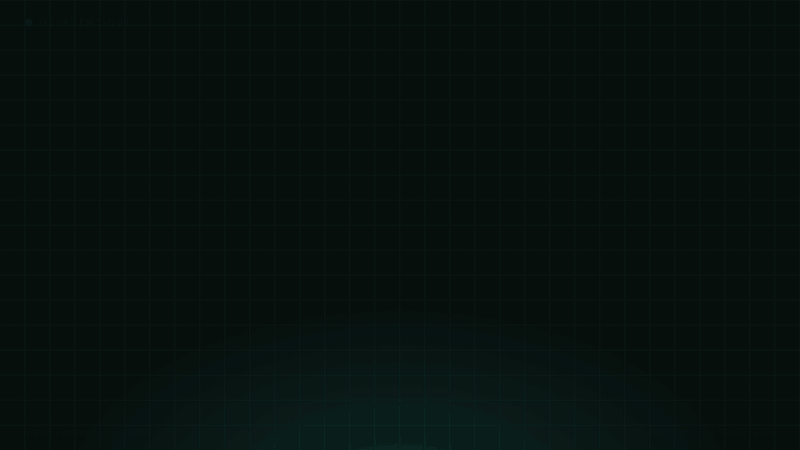
   
  <i>94 secondes pour comprendre le projet.</i> <a href="assets/presentation.fr.mp4"><b>Version HD (mp4)</b></a> · <a href="assets/presentation.en.mp4">English version</a>

> Ce dépôt est une **vitrine**. Le code source est dans un dépôt privé ; cette page montre ce que fait le système, comment je l'ai conçu, comment les briques ont été montées, et pourquoi. **Tout a été construit en un mois, le soir et le week-end, entièrement en « vibe coding » avec des agents IA** — c'est aussi ce que ce dépôt veut montrer : ce que l'on peut livrer, et à quelles conditions, quand l'IA écrit le code et qu'un humain tient la méthode.

---

## En bref

| | |
|---|---|
| **37 agents** répartis en **8 pôles** | Développement · RH & emploi · Sécurité défensive · Red Team · Commerce digital · Commercial · Secrétariat · Audit externe (+ une navigatrice web, et un atelier Coworking partagé) |
| **Un noyau qui tient l'équipe** | tout ce qui s'exécute démarre par un noyau nommé qui vérifie l'identité de l'appelant, délivre des **jetons de capacité** recontrôlés à chaque appel d'outil, écrit un **journal chaîné et signé**, et peut tout arrêter jusqu'au niveau d'un seul outil |
| **Des écritures en transaction** | une tâche qui modifie du code travaille dans un **worktree isolé** ; son diff m'est présenté avec son empreinte et attend une seconde approbation avant de s'intégrer |
| **Le cerveau de son choix** | changement en un clic : un modèle local de 25 milliards de paramètres sur ma carte graphique (RTX 4080, **0 €** par requête) ou Claude quand une tâche demande plus de puissance |
| **Une interface « orbitale »** | voix locale (« Hermès, … »), un **anneau** avec un satellite par pôle, **8 cockpits** plein écran, l'équipe en direct, les décisions qui m'attendent |
| **L'humain décide** | toute action à risque moyen ou élevé attend mon approbation ; une action à risque élevé vérifie ma présence par **Windows Hello** |
| **1 624 tests unitaires**, **112 tests de bout en bout** (Playwright), **25 tests de contrat** | comptés le jour de cette mise à jour ; les tests d'interface tournent sur une instance isolée, avec des **données fictives** |
| **112 décisions de conception écrites** (ADR) | chacune consigne le contexte, le choix, les alternatives écartées et la preuve |
| **≈ 95 000 lignes de TypeScript, 301 commits en 32 jours** | du 15 septembre au 16 octobre 2026 |
| **Construction toujours en cours** | développement actif : de nouvelles capacités sont ajoutées régulièrement |

---

## L'idée

Les agents IA savent désormais lire des fichiers, écrire du code, naviguer sur le web et lancer des commandes. C'est ce qui les rend utiles, et c'est aussi ce qui les rend risqués. Les outils devenus populaires en 2026 *confient souvent vos clés à l'agent* et comptent sur sa bonne conduite.

Je voulais l'inverse : **une équipe digne de confiance parce qu'elle est organisée comme une vraie entreprise.**

- **Un seul interlocuteur.** Je ne parle qu'au directeur. Il décide et délègue ; il ne touche jamais à rien lui-même. Il n'a ni web, ni fichiers, ni terminal : sa seule porte vers l'équipe est un serveur d'outils (MCP) borné.
- **Un organigramme clair.** Les managers planifient, seuls certains exécutants ont le droit d'écrire.
- **Des règles avant le pouvoir.** Chaque tâche reçoit un niveau de risque ; tout ce qui peut modifier quelque chose m'attend.
- **Des preuves, pas des promesses.** *« L'IA dit que c'est fait »* n'est jamais une preuve : le résultat est vérifié avant que la tâche soit close.
- **Une mémoire durable.** L'équipe tient un journal et apprend de ce qui l'a bloquée, quel que soit le modèle d'IA utilisé.
- **Privé par construction.** Le cerveau peut tourner entièrement sur mon PC ; mes données personnelles (mon CV, par exemple) ne sont traitées que par le modèle local ou par Claude, et sont techniquement empêchées d'arriver sur GitHub.

➡️ Toute l'histoire de sa conception : [**Conception & architecture**](docs/fr/conception.md)

---

## Comment ça marche, en une image

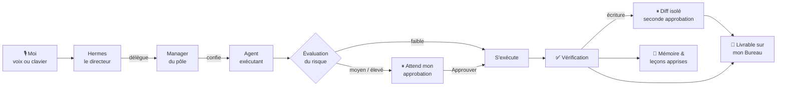

---

## La topologie : comment les briques ont été montées

Je n'ai pas réécrit un moteur d'agents. J'ai construit **autour** d'un moteur open source existant, étage par étage, chaque étage ne s'appuyant que sur celui du dessous. L'ordre ci-dessous est aussi, à peu de choses près, l'ordre dans lequel ils sont nés.

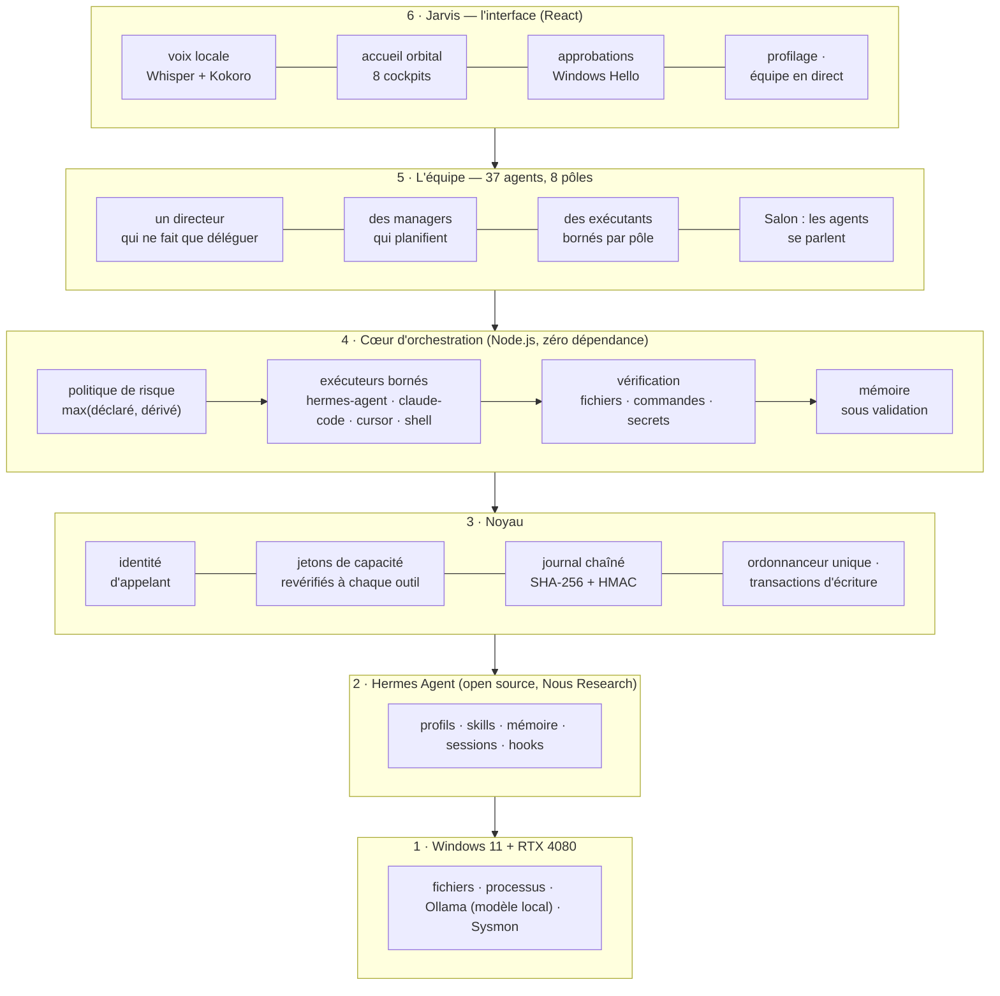

| Étage | Ce qu'il apporte | Ce qui l'a rendu nécessaire |
|---|---|---|
| **1 · La machine** | un modèle de 25 Md de paramètres servi en local, 0 € par requête ; la télémétrie système | la confidentialité de mes données, et le coût |
| **2 · Hermes Agent** | profils, skills, mémoire, sessions, et des *hooks* avant chaque appel d'outil | ne pas réécrire ce qui existe ; les hooks sont devenus mon **bus d'événements** |
| **3 · Le noyau** | qui demande, avec quels droits, dans quel périmètre ; un journal qu'on ne peut pas falsifier ; un seul ordonnanceur pour tous les processus | un audit interne (fin septembre) a montré que « la sécurité dans l'interface » n'était pas une garantie : elle devait être **dans le noyau** |
| **4 · Le cœur** | une machine à états par tâche, une politique de risque qui ne peut que monter, des exécuteurs à sortie bornée, une vérification obligatoire avant « terminé » | les trois questions de départ : qui décide, qu'est-ce qui est permis, comment je sais que ça a marché |
| **5 · L'équipe** | 37 cartes d'identité (une « âme » par agent), des pôles étanches, une usine à agents qui *propose* sans jamais activer | chaque nouveau besoin réel (emploi, sécurité, site, mission commerciale, factures) est devenu un pôle |
| **6 · Jarvis** | la voix, l'anneau des pôles, les cockpits, l'approbation, la preuve à l'écran | diriger une équipe exige de *voir* : qui travaille, sur quoi, et ce qui attend ma décision |

➡️ La chronologie complète, semaine par semaine : [**Comment ça a été construit**](docs/fr/construction.md)

---

## Un mois d'avancées

| Quand | Ce qui est arrivé | Preuve |
|---|---|---|
| **15 sept. — jour 1** | Le socle : « un OS d'agents, pas un empilement de scripts ». Huit plans écrits avant la moindre ligne : carte d'architecture, contrats, machines à états, modèle de menaces, plan de test. | ADR-001 → 005 |
| **Semaine 1** | Cœur d'orchestration : tâche en machine à états, politique de risque, vérification, exécuteurs bornés, planificateur, Coworking, moteur de frictions. Jarvis vocal. | ADR-006 → 029 |
| **Semaine 2** | Pôle RH : circuit CV relu, recherche d'emploi automatisée, données personnelles cloisonnées. Pôle sécurité défensive. Profilage, suivi en direct, alertes de dérive, sélecteur de cerveau, Coworking façon atelier partagé. | ADR-030 → 060 |
| **Semaine 3** | SOC local (Sysmon, broker à catalogue, Windows Hello). Le **noyau** : identité, jetons de capacité, arrêt au niveau de l'outil, processus enfants bornés, journal signé, ordonnanceur unique. Salon d'agents, mémoire sous validation, pôle Commerce digital. | ADR-061 → 097 |
| **Semaine 4** | Administration serveur par recettes, veille de marché autonome, **gate frontend** (Playwright + lint de design), **transactions d'écriture**, pôles Commercial, Audit externe, post-mortems, mentor carrière, Secrétariat en conditions réelles, puis la **refonte orbitale de Jarvis** et ses 8 cockpits. | ADR-098 → 114 |

---

## L'équipe

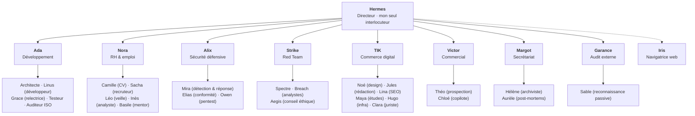

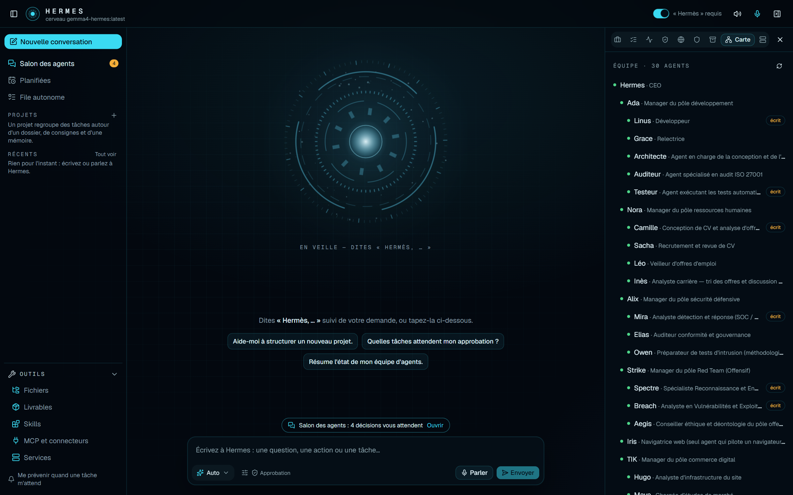

> La carte vivante, telle que Hermes la lit avant chaque décision : chaque agent, son pôle, son rôle et le badge « écrit » pour les rares exécutants autorisés à modifier des fichiers. *(Capture d'une version à 30 agents ; l'équipe en compte 37 aujourd'hui.)*

| Pôle | Ce qu'il fait pour moi |
|---|---|
| **Développement** — Ada | conçoit, écrit, relit et teste du code ; peut confier des travaux à Claude Code ou Cursor, toujours sous approbation et dans un worktree isolé |
| **RH & emploi** — Nora | trouve et trie les offres (sources réelles), transforme une annonce en CV adapté **relu avant livraison**, prépare lettres et entretiens ; Basile, le mentor, tient une feuille de route de reconversion que je valide |
| **Sécurité défensive** — Alix | règles de détection, analyse d'incidents, conformité ISO 27001, méthodologie et rapports de pentest, adossés à un **SOC local** et à un cockpit **GRC** |
| **Red Team** — Strike | émulation d'adversaire à visée défensive, sur un périmètre que **moi seul** inscris. Toute tâche de ce pôle est **forcée au niveau de risque maximal** : jamais d'automatique, un **conseiller éthique** (Aegis) vérifie autorisation, périmètre et légalité, et le pôle ne se délègue jamais |
| **Commerce digital** — TIK | un pôle produit complet (design, rédaction, SEO, études, infra, juridique) pour construire et faire vivre un vrai site, derrière une frontière stricte « web ⊕ privilège » et des faits toujours sourcés |
| **Commercial** — Victor | une mission commerciale réelle (carte cadeau locale) : prospection sur le web public sans aucune coordonnée, préparation des échanges, CRM et relances **tenus par le code** ; **rien n'est jamais envoyé par le système** |
| **Secrétariat** — Margot | factures et pièces administratives : collecte, lecture **locale** de chaque pièce par Hélène, classement, les cas douteux « à mon attention » ; Aurèle rédige les post-mortems d'incident |
| **Audit externe** — Garance | revues d'exposition publique **passives** (pages publiques, certificats, registres) sur mes actifs ou sous mandat écrit ; chaque constat doit être prouvé par le journal des lectures |
| **Navigatrice web** — Iris | le **seul** agent qui pilote un navigateur, à la vue de l'opérateur, derrière un garde-fou déterministe |
| **Coworking** *(mode)* | un atelier partagé où l'équipe et moi travaillons ensemble sur un projet, avec un fil d'activité lisible et un journal infalsifiable |

➡️ Qui est chaque agent et ce qu'il fait : [**L'équipe**](docs/fr/equipe.md)

---

## Jarvis : un anneau, huit cockpits

L'interface a été entièrement repensée mi-octobre. L'accueil est un **anneau en perspective** portant un satellite par pôle ; au centre, un hexagone affiche le chiffre qui compte pour le pôle sélectionné et ce qui attend ma décision. Un clic ouvre le **cockpit** du pôle, plein écran.

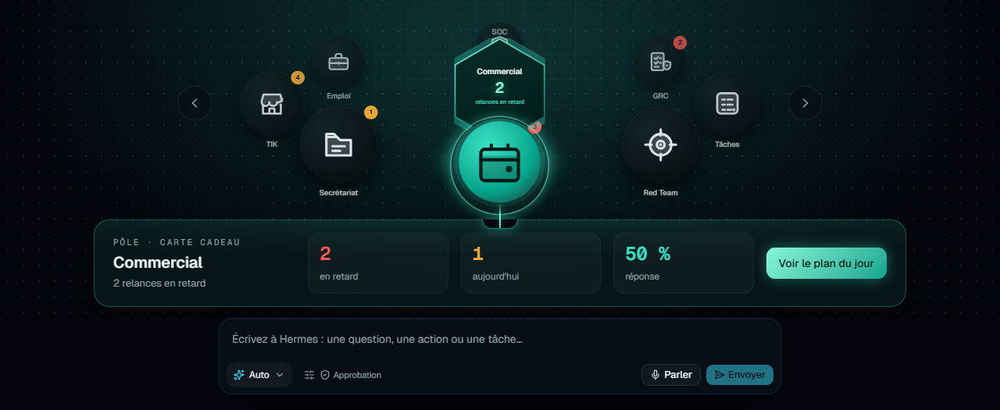

> Les captures de cette section sont **réelles** mais prises sur l'instance de test, avec des **données fictives** (c'est ainsi que les tests d'interface sont écrits : aucun écran n'est accepté sans sa fixture fictive et sa capture).

| Cockpit Tâches | Cockpit GRC |
|---|---|
| 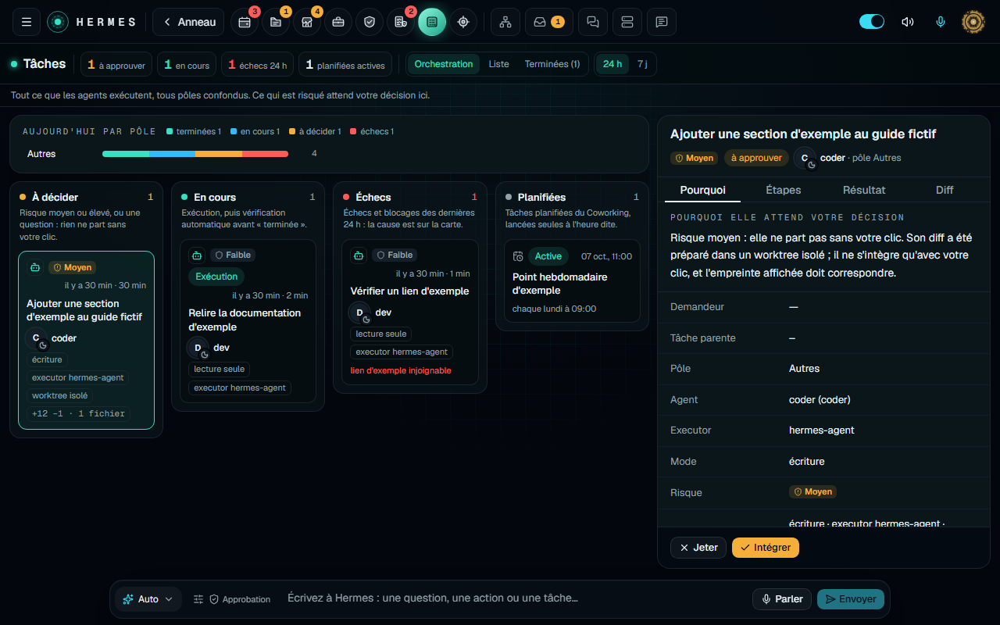 | 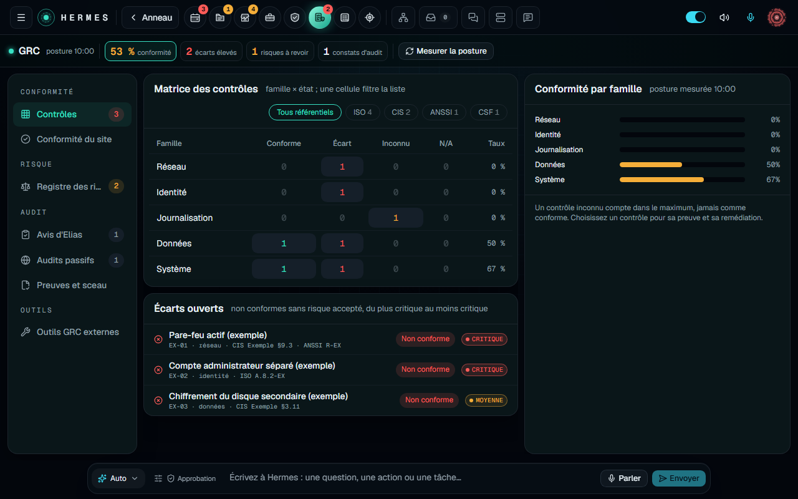 |
| tout ce que les agents exécutent, tous pôles confondus ; une tâche risquée explique **pourquoi** elle attend mon clic, et son diff a été préparé dans un worktree isolé | la posture de conformité : matrice des contrôles, écarts classés, avis d'Elias, audits passifs, preuves et sceau |

| Cockpit Emploi | L'équipe en direct |
|---|---|
| 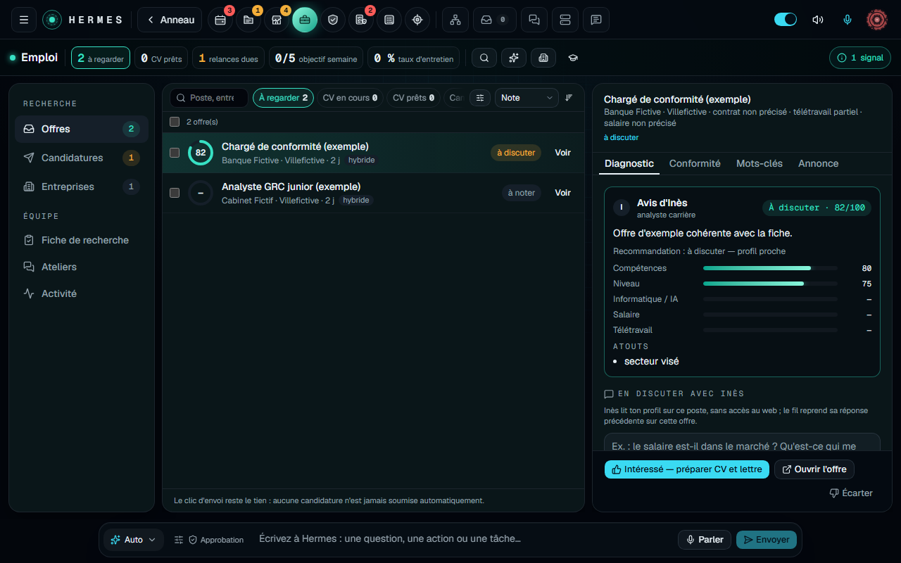 | 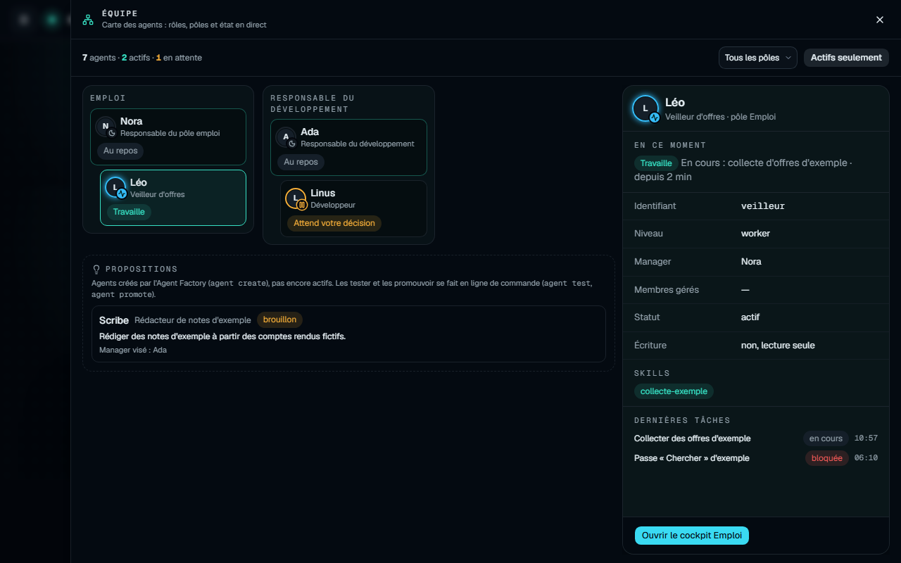 |
| les offres notées par Inès (grille explicable), le diagnostic, et le bouton « préparer CV et lettre » ; le clic « postuler » reste le mien | qui travaille, sur quoi, depuis quand ; la fiche de chaque agent ; les agents **proposés** par l'usine à agents, avant d'exister |

Les règles de cette interface sont elles-mêmes gardées par le code : un **système de design** écrit (tokens, composants, accessibilité), un **lint de design** qui refuse une couleur en dur ou un bouton sans effet, et une **gate** (typage, lint, build, budget des bundles, Playwright sur trois largeurs) qui doit être verte avant toute fusion.

➡️ Le parcours d'une journée, étape par étape : [**Une journée avec Hermes**](docs/fr/parcours.md)

---

## Profilage en direct : voir ce que fait chaque agent

Diriger une équipe, c'est savoir qui travaille, sur quoi, combien de temps et pour quel coût. OS-Agentique dispose d'une **console de profilage** qui répond à ces questions pour chaque agent. Les chiffres sont lus dans les propres journaux du moteur, pas estimés par une IA.

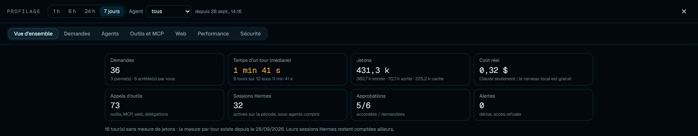

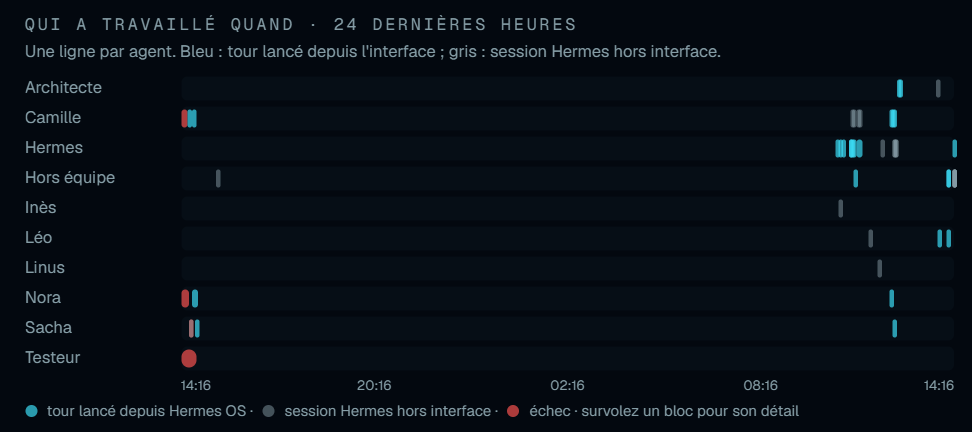

**Par agent :** demandes, échecs, temps de travail, temps de réflexion du modèle, appels d'outils, jetons, coût et outils favoris. **Par outil :** chaque outil et serveur MCP utilisé, combien de fois, en combien de temps, et par quels agents.

| Par agent | Par outil |
|---|---|
| 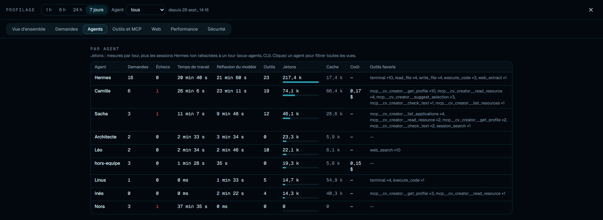 | 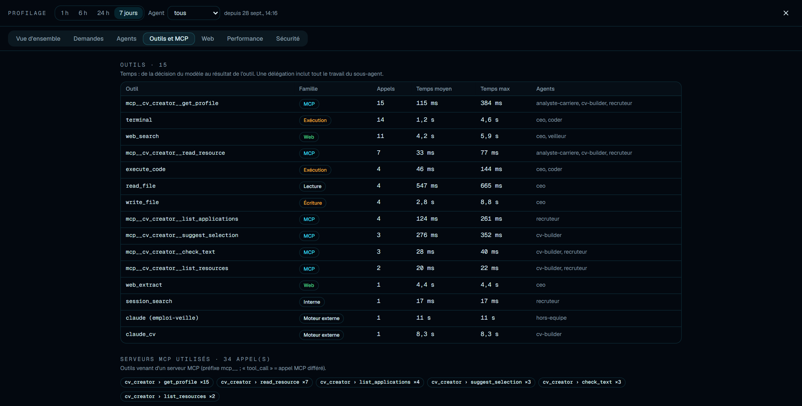 |

**Et en direct :** le suivi montre ce qui se passe *maintenant*, même quand plusieurs tâches tournent en parallèle, avec chaque étape (outil, durée, agent délégué) et des **alertes de dérive** déterministes : une écriture pendant une tâche en lecture seule, une délégation vers un pôle sensible, une boucle, des échecs répétés.

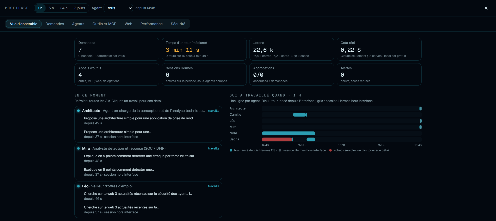

> **Pourquoi c'est important :** l'observabilité transforme une boîte noire en une équipe qu'on peut diriger.

---

## Changer de cerveau, garder l'équipe

Hermes reste le même ; seul le cerveau derrière lui change. Depuis l'onglet **Systèmes**, je fais passer toute l'équipe d'un modèle local, sur ma carte graphique, à Claude, et inversement, en une quinzaine de secondes.

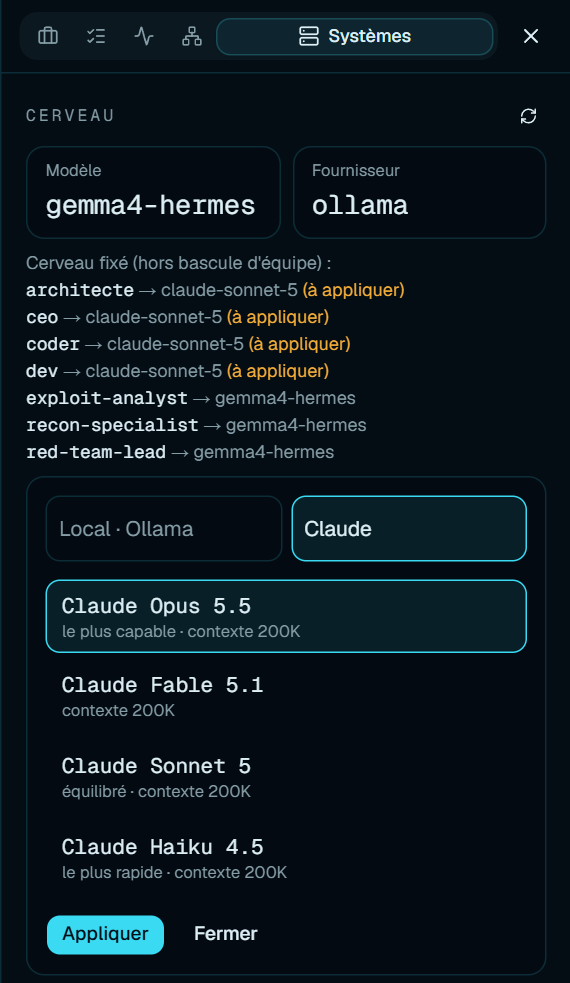

- **En local** quand je veux la confidentialité et le coût zéro ; **Claude** pour un travail exigeant.
- **Certains agents gardent un cerveau fixe** : le directeur et une partie du pôle développement tournent sur Claude ; la **Red Team** et le **Salon** restent toujours en local ; les agents RH refusent tout fournisseur autre que le modèle local ou Claude.
- **Liste fermée :** seuls des modèles testés peuvent être choisis, aucune saisie libre.

---

## Sous le capot : un noyau pour les agents

Au début, l'interface était la sécurité. Désormais, la sécurité est **dans le noyau**. Tout ce qui s'exécute — un tour de conversation, une tâche, un sous-agent, un script planifié — démarre par un **noyau nommé**, un ordonnanceur unique qui partage son état entre les processus.

- **Identité de l'appelant.** Chaque tour sait *qui* le demande (moi, un jeton local, ou un agent, avec des droits différents). Rien n'agit de façon anonyme.
- **Jetons de capacité.** Le noyau accorde à un tour un jeu précis de droits (outils, mode lecture ou écriture, périmètre), signé, et **revérifié à chaque appel d'outil** par un hook : un refus intervient *avant* l'effet.
- **Transactions d'écriture.** Une tâche qui modifie du code travaille dans un worktree isolé ; son diff attend une seconde approbation, liée à son empreinte, avant de s'intégrer. Hors transaction : lecture seule.
- **Politique en données.** Les règles de risque sont un fichier scellé, relu par un `policy simulate` qui explique *pourquoi* une tâche serait relevée ou refusée.
- **Arrêt jusqu'au niveau de l'outil.** L'arrêt d'urgence s'applique à un outil précis, sur tous les profils ; la garde du navigateur l'applique elle-même.
- **Processus enfants bornés.** Quand un agent lance Claude Code, Cursor ou un shell, l'enfant n'hérite d'**aucun nom de secret**, ses sorties sont bornées, et il est réellement interruptible.
- **Un journal unique, chaîné et signé.** Chaque événement est inscrit dans un journal chaîné par empreintes et signé ; une clé étrangère ne peut plus y écrire, et toute signature inattendue doit être **attestée** par moi, sous Windows Hello.

> **Pourquoi c'est important :** une règle de sécurité ne vaut que si le système l'impose lui-même. Déplacer la frontière de l'écran vers le noyau, c'est passer d'une politesse à une garantie.

---

## Un SOC local et un cockpit GRC

Le pôle sécurité défensive ne fait pas que donner des conseils : il s'appuie sur un **centre de supervision (SOC) qui tourne sur le poste**, adossé au noyau, et sur un cockpit de **gouvernance, risque et conformité**.

- **Télémétrie réelle** (dont Sysmon avec une configuration maison), normalisée, où chaque sortie réseau est rattachée à l'agent qui l'a provoquée.
- **Registre des sorties des agents** : ce que chaque agent tente vers l'extérieur, classé ; un hook temps réel coupe le réseau aux profils sensibles.
- **Broker à catalogue** : les actions privilégiées passent par une liste fermée, avec une **élévation UAC par action**.
- **Audit chaîné, sceau, arrêt d'urgence et mode sûr** pour garder le contrôle même en cas d'incident ; des **post-mortems** générés par le code et validés par moi.
- **GRC** : matrice de contrôles (ISO 27001, CIS, ANSSI, NIST CSF), registre des risques, avis de conformité d'Elias, audits externes passifs, et un lanceur vers des outils GRC externes.

> Présenté ici dans les grandes lignes : ce dépôt montre l'intention et les garde-fous, pas les détails opérationnels.

---

## Le Salon d'agents : l'équipe qui se parle

Une équipe n'est pas qu'un arbre de délégation. OS-Agentique a un **Salon** : un fil visible où les agents échangent entre eux, sur le cerveau **local**, dans un cadre borné par une politique.

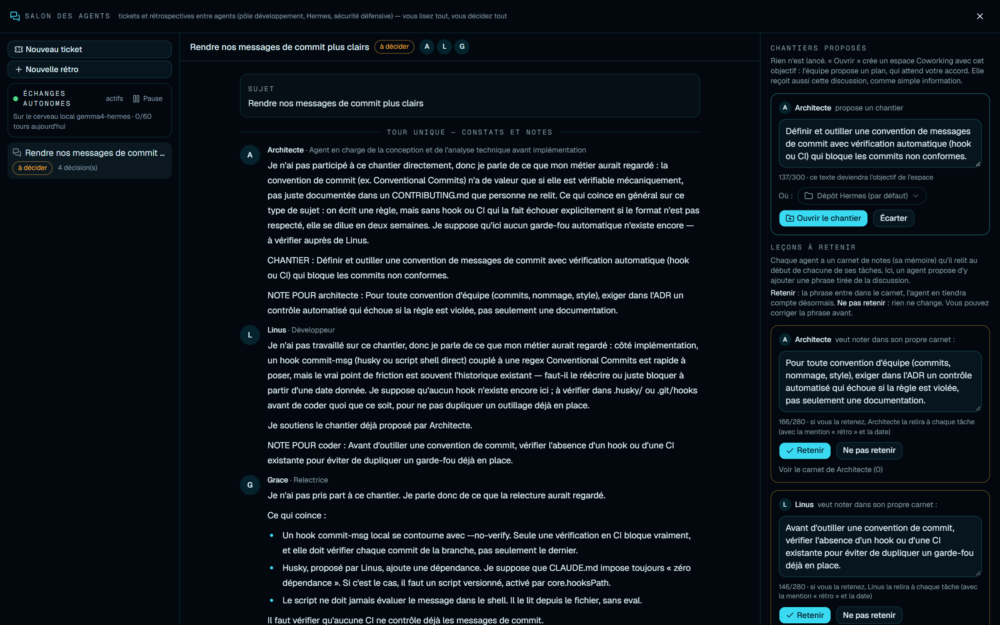

- Un agent peut **ouvrir un ticket**, en mentionner un autre, joindre une pièce (un diff, une erreur) ; le fil suit le chantier qu'il a fait naître.
- Les agents **proposent des notes de mémoire** et des **chantiers** ; rien n'est retenu ni ouvert sans ma validation.
- Le salon peut **tenir des semaines sans surveillance** (répartiteur incassable, tickets inactifs clos, historique borné).

---

## La mémoire, mais sous validation

Les agents apprennent, mais ne décident pas seuls de ce qu'ils retiennent. Jarvis a une file **« Mémoires en attente »** : chaque note proposée m'est présentée pour **Valider** ou **Refuser**, et c'est le moteur lui-même qui applique ma décision. Ce que je demande de retenir **sur moi** s'écrit dans mes propres tours ; le reste attend mon feu vert.

---

## Des pôles qui font du vrai travail

**Commerce digital (TIK).** Un pôle produit complet autour d'un site réel : missions à portes (chaque fait doit avoir une source), pipeline de contenu avec plafond de publication, audit SEO des fichiers construits, passerelle hébergeur en lecture d'abord, **panneau d'administration du serveur** par recettes journalisées (console SSH incluse), et une **veille de marché hebdomadaire autonome** dont rien n'est publié sans moi.

**Commercial.** Une mission réelle pour une carte cadeau locale : le prospecteur repère sur le web public **sans jamais recevoir une coordonnée**, la copilote prépare les échanges **sans web**, le CRM, le planning de la semaine et les relances sont du code ; un brouillon d'e-mail peut être préparé, **jamais envoyé**.

**Secrétariat.** Collecte des pièces dans la messagerie par une extension (du code, pas un agent), lecture **locale** par Hélène, classement dans le Drive, règles de tri, exceptions « à mon attention ». Le directeur ne voit jamais une pièce, un nom ni un montant : seulement des comptes.

**Audit externe.** Revues **passives** d'exposition publique, sur un périmètre que j'écris moi-même ; un constat sans preuve au journal de méthode est rejeté.

**Mentor carrière.** Basile tient une feuille de route de reconversion (étapes, certifications), chaque proposition validée par moi ; ses recherches passent par Iris, sur une liste fermée de sites.

---

## Construit en vibe coding : la méthode

Tout le code de ce projet a été écrit par des agents IA (Claude Code, et ponctuellement Cursor), dirigés par moi. Ce n'est tenable que si la **méthode** tient : c'est elle que ce dépôt veut montrer autant que le produit.

| Règle | Ce que ça change |
|---|---|
| **Une porte avant le code** | chaque fonctionnalité répond d'abord à WHAT · WHY · INTERFACE · SECURITY · TEST · ROLLBACK ; pas de code sans ça |
| **Chaque décision écrite** | 112 ADR : contexte, choix, alternatives écartées, preuve. Quand une décision est amendée, l'ADR le dit |
| **Les plans d'abord** | les gros chantiers (noyau, SOC, pôles, refonte d'interface) commencent par un document de conception relu, puis des **lots** livrés verts un par un |
| **Constructeur ≠ vérificateur** | un agent construit dans son worktree, un autre relit, mesure à l'écran et lance la gate ; deux sessions n'écrivent jamais les mêmes fichiers |
| **La preuve, pas la promesse** | tests isolés (jamais sur les vrais dossiers), tests de contrat pour chaque outil externe, Playwright sur données fictives, lint de design ; « le LLM dit que c'est fait » n'est jamais une preuve |
| **Script plutôt que LLM** | tout ce qui est mécanique est un script déterministe ; le modèle propose, le code décide |
| **Reproductible** | une installation en une commande, idempotente, testée ; tout geste manuel non noté est considéré perdu |
| **Sauvegarde horaire** | un checkpoint automatique commite et pousse, avec un détecteur de secrets et de données privées qui bloque tout diff douteux |
| **Audits réguliers** | des audits internes (application, runtime agentique, UX) ont réorienté le projet plusieurs fois ; les incidents ont leur post-mortem |

**Ce que ça m'a appris**, et ce que ce projet me permet de montrer :

- **Orchestration d'agents** : délégation, outils MCP, jeux d'outils par rôle, isolement par profil, protocoles de vérification.
- **Sécurité par conception** : modèle de menaces, moindre privilège, jetons de capacité, journaux chaînés, SOC, Windows Hello, séparation web ⊕ privilège.
- **Gouvernance, risque et conformité** : ADR, politiques en données, matrice de contrôles, audits passifs, post-mortems, traçabilité.
- **Ingénierie** : TypeScript / Node.js (sans dépendance à l'exécution), React · Vite · Tailwind, PowerShell 7, SQLite, Playwright, node:test, git (worktrees, hooks).
- **IA en local** : Ollama, choix et banc d'essai d'un modèle, voix locale (Whisper, Kokoro), coûts maîtrisés.
- **Produit et UX** : prototypes HTML validés avant le code, système de design, accessibilité, preuve navigateur.

➡️ Les choix techniques dont je suis le plus fier : [**Décisions clés**](docs/fr/decisions.md)

---

## Technologies

| Couche | Technologie |
|---|---|
| Moteur d'agents | [Hermes Agent](https://github.com/NousResearch/hermes-agent) (Nous Research) : profils, skills, mémoire, hooks |
| Cerveau IA | au choix depuis l'interface : modèle local servi par Ollama (RTX 4080) ou Claude par abonnement |
| Noyau | ordonnanceur unique, identité d'appelant, jetons de capacité signés, transactions d'écriture, politique en données, journal chaîné signé, arrêt au niveau de l'outil |
| Cœur d'orchestration | Node.js / TypeScript, **aucune dépendance à l'exécution** |
| Interface | React, TypeScript, Tailwind, Vite ; système de design écrit, lint de design, Playwright |
| Voix | Whisper (voix → texte) et Kokoro (texte → voix), 100 % local |
| Outils externes | serveurs MCP (CV Creator, passerelle « hermes-os »), avec un test de contrat par outil |
| SOC / GRC | télémétrie (Sysmon, config maison), broker à catalogue, élévation UAC par action, audit chaîné, matrice de contrôles |
| Exécuteurs | Claude Code, Cursor, shell à liste blanche, pipeline CV, missions TIK, shell d'administration serveur |
| Scripts | PowerShell 7 : installation reproductible en une commande (tests Pester) |

---

## Sa place parmi les « OS agentiques »

| | Qui tient l'agent ? |
|---|---|
| OS agentique de recherche (ex. AIOS) | le système d'exploitation lui-même, repensé pour les agents |
| Windows 11 agentique | Windows : un compte et un espace séparés pour chaque agent |
| Assistants de bureau (OpenClaw, Manus…) | surtout la bonne conduite de l'agent |
| **OS-Agentique** | **des règles explicites, une politique de risque, un noyau qui les impose, la vérification et mon approbation** |

OS-Agentique est une **couche d'orchestration d'agents** : un « OS agentique » au sens où l'entend le monde de l'entreprise, qui tourne au-dessus de Windows. La prochaine étape est de faire tourner les agents qui écrivent sous un compte Windows dédié et restreint, pour que les règles soient aussi imposées par le système d'exploitation.

---

<i>Conçu et réalisé par <a href="https://github.com/Dow08"><b>Dow08</b></a></i>

