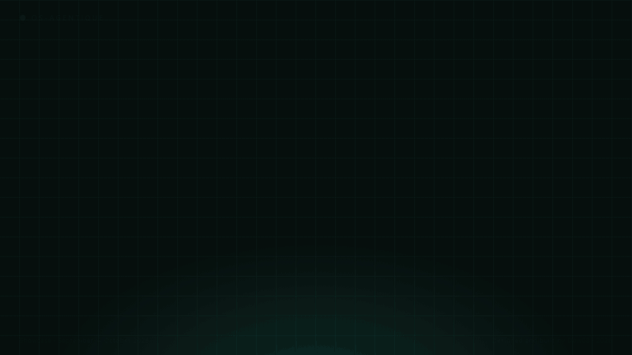
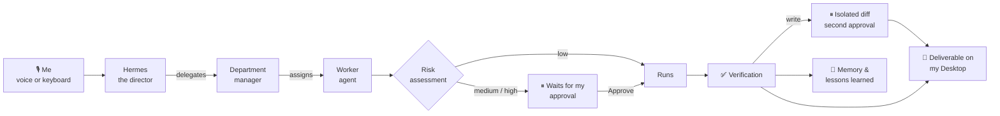
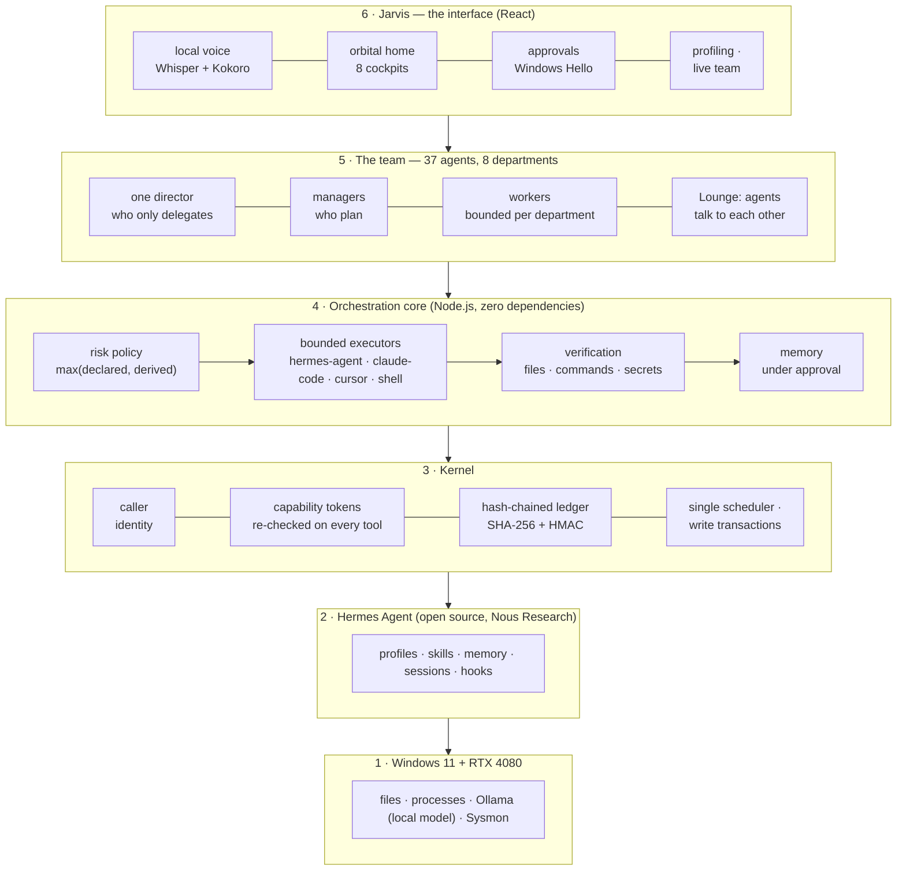
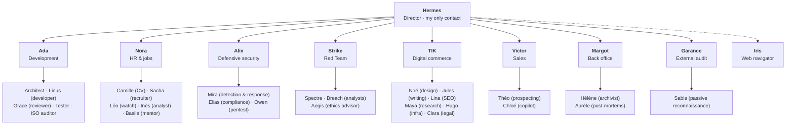
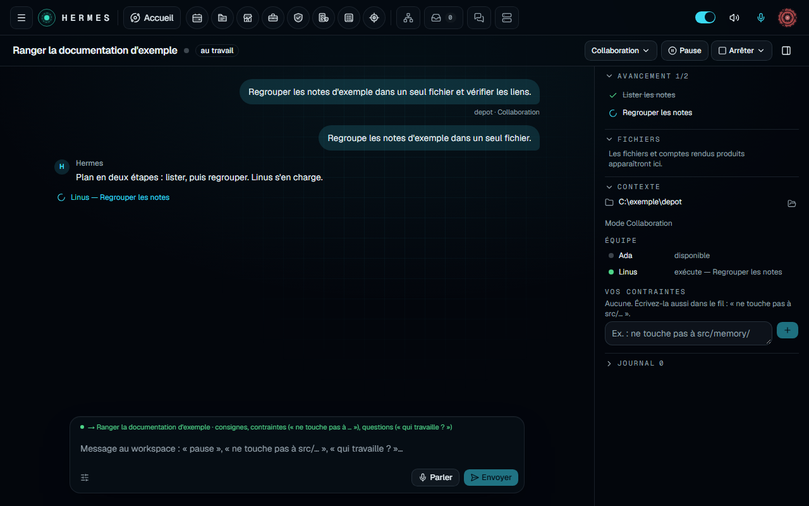
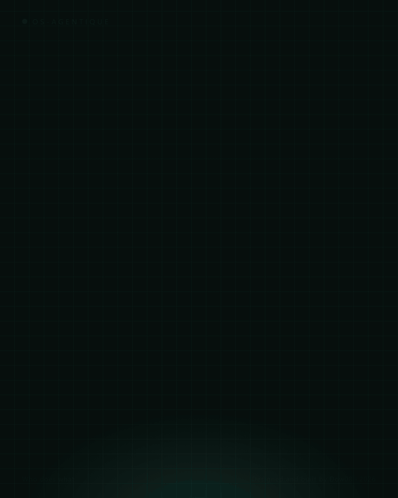
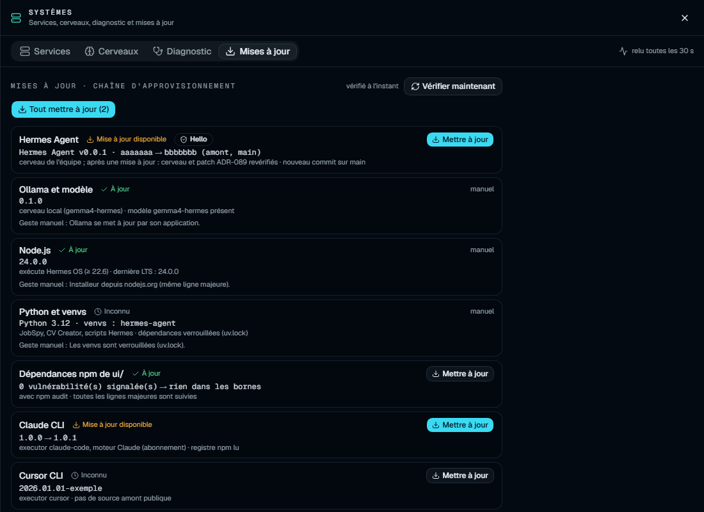
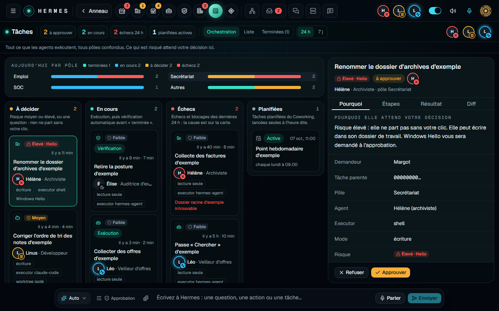
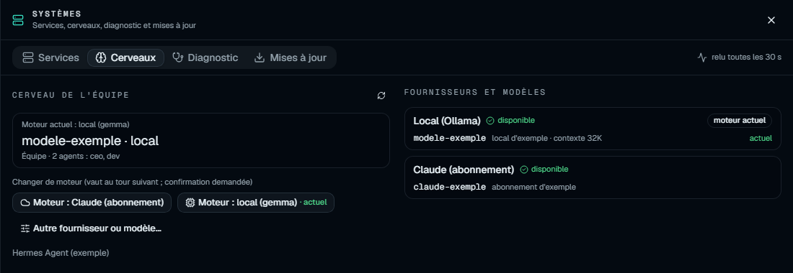
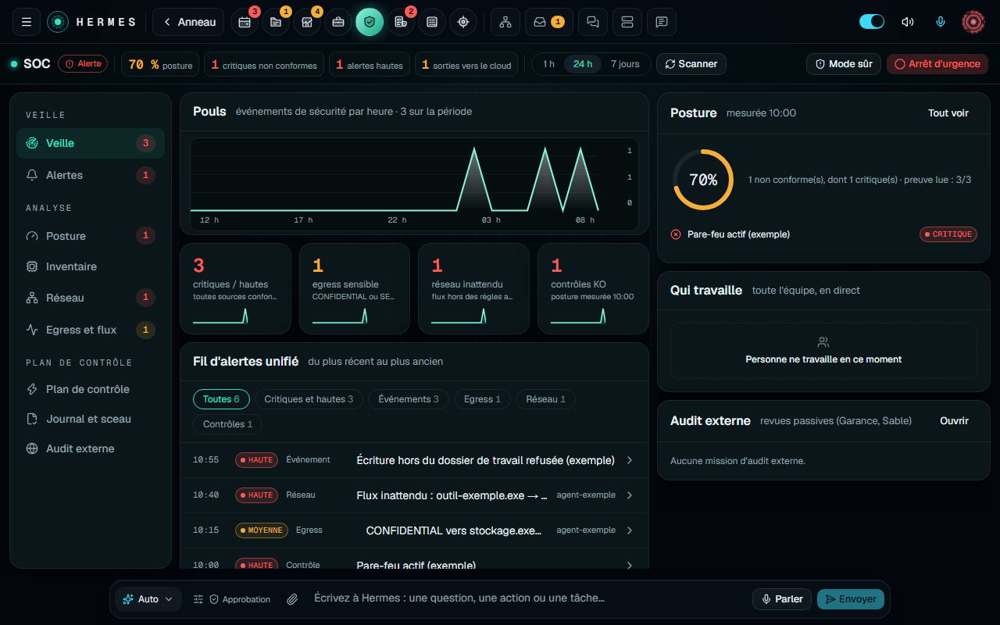

<b>English</b> · <a href="README.fr.md">Français</a>

# OS-Agentique

**A personal team of AI agents that runs on my own PC, talks to me by voice, and never acts without my approval.**

OS-Agentique turns a Windows 11 workstation into a small, well-run company of AI agents. I talk to a single director, *Hermes*. He understands the request, hands the work to the right department, and every sensitive action waits for my click on **Approve**. Nothing counts as done until it has been verified.

  
   
  <i>94 seconds to understand the project.</i> <a href="assets/presentation.en.mp4"><b>HD version (mp4)</b></a> · <a href="assets/presentation.fr.mp4">Version française</a>

> This repository is a **showcase**. The source code lives in a private repository; this page shows what the system does, how I designed it, how the bricks were stacked, and why. **Everything was built in one month, evenings and weekends, entirely by “vibe coding” with AI agents** — and that is the second thing this repository wants to show: what can be shipped, and under which conditions, when AI writes the code and a human holds the method.

---

## At a glance

| | |
|---|---|
| **37 agents** in **8 departments** | Development · HR & jobs · Defensive security · Red Team · Digital commerce · Sales · Back office · External audit (+ a web navigator, and a shared Coworking workshop) |
| **A kernel that holds the team** | everything that runs starts through a named kernel that checks the caller's identity, issues **capability tokens** re-checked on every tool call, writes a **hash-chained, signed ledger**, and can stop everything down to a single tool |
| **Writes as transactions** | a task that changes code works in an **isolated worktree**; its diff is shown to me with its fingerprint and waits for a second approval before it is merged |
| **The brain of my choice** | one click: a 25-billion-parameter model on my own graphics card (RTX 4080, **$0** per request) or Claude when a task needs more power |
| **An “orbital” interface** | local voice (“Hermes, …”), a **ring** with one satellite per department, **8 full-screen cockpits**, the live team, the decisions waiting for me |
| **The human decides** | every medium or high-risk action waits for my approval; a high-risk action checks my presence with **Windows Hello** |
| **1,624 unit tests**, **127 end-to-end tests** (Playwright), **26 contract tests** | counted on 17 October 2026; UI tests run on an isolated instance with **fictional data** |
| **114 written design decisions** (ADRs) | each records the context, the choice, the rejected alternatives and the evidence |
| **≈ 95,000 lines of TypeScript, 328 commits in 33 days** | from 15 September to 17 October 2026 |
| **Work in progress** | active development: new capabilities are added regularly |

---

## The idea

AI agents can now read files, write code, browse the web and run commands. That is what makes them useful, and also what makes them risky. The tools that became popular in 2026 often *hand your keys to the agent* and rely on its good behaviour.

I wanted the opposite: **a team you can trust because it is organised like a real company.**

- **One single contact.** I only talk to the director. He decides and delegates; he never touches anything himself. He has no web, no files, no terminal: his only door to the team is a bounded tool server (MCP).
- **A clear org chart.** Managers plan, only a few workers are allowed to write.
- **Rules before power.** Every task gets a risk level; anything that can change something waits for me.
- **Proof, not promises.** *“The AI says it's done”* is never evidence: the result is verified before the task is closed.
- **Durable memory.** The team keeps a journal and learns from what blocked it, whatever AI model is in use.
- **Private by construction.** The brain can run entirely on my PC; my personal data (my CV, for instance) is only handled by the local model or by Claude, and is technically prevented from reaching GitHub.

➡️ The whole design story: [**Design & architecture**](docs/en/design.md)

---

## How it works, in one picture

---

## The topology: how the bricks were stacked

I did not rewrite an agent engine. I built **around** an existing open-source engine, layer by layer, each layer resting only on the one below. The order below is also, roughly, the order in which they were born.

| Layer | What it brings | What made it necessary |
|---|---|---|
| **1 · The machine** | a 25B-parameter model served locally, $0 per request; system telemetry | the privacy of my data, and cost |
| **2 · Hermes Agent** | profiles, skills, memory, sessions, and *hooks* before every tool call | not rewriting what exists; the hooks became my **event bus** |
| **3 · The kernel** | who is asking, with which rights, in which scope; a ledger that cannot be tampered with; a single scheduler for every process | an internal audit (late September) showed that “security in the UI” was not a guarantee: it had to live **in the kernel** |
| **4 · The core** | a state machine per task, a risk policy that can only go up, executors with bounded output, mandatory verification before “done” | the three starting questions: who decides, what is allowed, how do I know it worked |
| **5 · The team** | 37 identity cards (one “soul” per agent), sealed departments, an agent factory that *proposes* but never activates | every real need (jobs, security, website, sales mission, invoices) became a department |
| **6 · Jarvis** | voice, the ring of departments, the cockpits, approval, proof on screen | running a team requires *seeing*: who is working, on what, and what awaits my decision |

➡️ The full week-by-week chronology: [**How it was built**](docs/en/build-log.md)

---

## One month of progress

| When | What happened | Evidence |
|---|---|---|
| **15 Sept — day 1** | The foundation: “an agent OS, not a pile of scripts”. Eight blueprints written before a single line: architecture map, contracts, state machines, threat model, test plan. | ADR-001 → 005 |
| **Week 1** | Orchestration core: task state machine, risk policy, verification, bounded executors, planner, Coworking, friction engine. Voice-driven Jarvis. | ADR-006 → 029 |
| **Week 2** | HR department: reviewed CV pipeline, automated job search, personal data compartmentalised. Defensive security department. Profiling, live tracking, drift alerts, brain selector, Coworking as a shared workshop. | ADR-030 → 060 |
| **Week 3** | Local SOC (Sysmon, catalogue broker, Windows Hello). The **kernel**: identity, capability tokens, tool-level kill switch, bounded child processes, signed ledger, single scheduler. Agents' lounge, memory under approval, Digital commerce department. | ADR-061 → 097 |
| **Week 4** | Server administration by recipes, autonomous market watch, **frontend gate** (Playwright + design lint), **write transactions**, Sales, External audit, post-mortems, career mentor, Back office in real conditions, the **orbital redesign of Jarvis** and its 8 cockpits, then supply-chain updates and chat attachments. | ADR-098 → 116 |

---

## The team

> The living map, as Hermes reads it before every decision: each agent, its department, its role and the “writes” badge for the few workers allowed to modify files. *(Screenshot of a 30-agent version; the team now has 37.)*

| Department | What it does for me |
|---|---|
| **Development** — Ada | designs, writes, reviews and tests code; can hand work to Claude Code or Cursor, always under approval and in an isolated worktree |
| **HR & jobs** — Nora | finds and sorts job offers (real sources), turns an advert into a tailored CV **reviewed before delivery**, prepares cover letters and interviews; Basile, the mentor, keeps a retraining roadmap that I validate |
| **Defensive security** — Alix | detection rules, incident analysis, ISO 27001 compliance, pentest methodology and reports, backed by a **local SOC** and a **GRC** cockpit |
| **Red Team** — Strike | adversary emulation for defensive purposes, on a scope that **only I** write. Every task of this department is **forced to the maximum risk level**: never automatic, an **ethics advisor** (Aegis) checks authorisation, scope and legality, and the department is never delegated to |
| **Digital commerce** — TIK | a full product department (design, writing, SEO, research, infra, legal) to build and run a real website, behind a strict “web ⊕ privilege” boundary and always-sourced facts |
| **Sales** — Victor | a real sales mission (a local gift card): prospecting on the public web without any contact details, preparation of calls and visits, CRM and follow-ups **kept by code**; **nothing is ever sent by the system** |
| **Back office** — Margot | invoices and administrative documents: collection, **local** reading of each document by Hélène, filing, doubtful cases “for my attention”; Aurèle writes incident post-mortems |
| **External audit** — Garance | **passive** public-exposure reviews (public pages, certificates, registries) on my assets or under written mandate; every finding must be proven by the reading log |
| **Web navigator** — Iris | the **only** agent that drives a browser, in plain sight of the operator, behind a deterministic guard |
| **Coworking** *(mode)* | a shared workshop where the team and I work together on a project, with a readable activity feed and a tamper-evident journal |

> Coworking mode (test instance, fictional data): I set the goal, Hermes plans, the team executes step by step, and I can add a constraint at any time.

### Who does what, from A to Z

How a single request travels through the team: the director delegates, Léo searches the web without ever seeing my data, Inès scores the offers without ever touching the web, I choose, Camille writes, Sacha reviews, the result is verified, and the final click stays mine.

  
   
  <i>75 seconds.</i> <a href="assets/equipe-qui-fait-quoi.en.mp4"><b>HD version (mp4)</b></a> · <a href="assets/equipe-qui-fait-quoi.fr.mp4">Version française</a>

➡️ Who each agent is and what it does: [**The team**](docs/en/team.md)

---

## Jarvis: a ring and eight cockpits

The interface was fully redesigned in mid-October. The home is a **ring in perspective** carrying one satellite per department; in the centre, a hexagon shows the number that matters for the selected department and what awaits my decision. One click opens the department's **cockpit**, full screen.

> The screenshots in this section are **real** but taken on the test instance, with **fictional data** (that is how the UI tests are written: no screen is accepted without its fictional fixture and its screenshot).

| Tasks cockpit | GRC cockpit |
|---|---|
|  |  |
| everything the agents run, all departments together; a risky task explains **why** it waits for my click, and its diff was prepared in an isolated worktree | the compliance posture: control matrix, ranked gaps, Elias's opinion, passive audits, evidence and seal |

| Jobs cockpit | The live team |
|---|---|
|  |  |
| offers scored by Inès (an explainable grid), the diagnosis, and the “prepare CV and letter” button; the “apply” click stays mine | who is working, on what, since when; each agent's card; agents **proposed** by the agent factory, before they exist |

**Systems** gathers what keeps the whole thing running: services, the choice of brain, a diagnostic, and since mid-October the **supply-chain updates** (agent engine, local model, Node.js, dependencies, command-line tools): every version is read, an update is a task to approve, never a free command.

The conversation also accepts **attachments** (images, text, PDF) sent to the director within a turn, bounded in size and type.

The rules of this interface are themselves enforced by code: a written **design system** (tokens, components, accessibility), a **design lint** that rejects a hard-coded colour or a button with no effect, and a **gate** (type-check, lint, build, bundle budget, Playwright at three widths) that must be green before any merge.

➡️ A day with the system, step by step: [**A day with Hermes**](docs/en/walkthrough.md)

---

## Live profiling: see what every agent does

Running a team means knowing who is working, on what, for how long and at what cost. OS-Agentique has a **profiling console** that answers these questions for every agent. The numbers are read from the engine's own logs, not estimated by an AI.

> Screenshots from late September on the real instance (structured areas only). Profiling lives in the side panel, unchanged by the redesign.

**Per agent:** requests, failures, working time, model thinking time, tool calls, tokens, cost and favourite tools. **Per tool:** every tool and MCP server used, how many times, how long, and by which agents.

| Per agent | Per tool |
|---|---|
|  |  |

**And live:** an agent ticker in the bar (blue: working, amber: waiting for my decision, red: failed, mint: done) and, in the Tasks cockpit, every task with its agent, mode, executor and the reason it is waiting. Deterministic **drift alerts** watch every task: a write during a read-only task, a delegation to a sensitive department, a loop, repeated failures.

> Test instance, fictional data: Hélène waits for my approval under Windows Hello, Linus works in an isolated worktree, Léo has a failed pass whose cause is displayed.

> **Why it matters:** observability turns a black box into a team you can actually run.

---

## Choose the brain, keep the team

Hermes stays the same; only the brain behind him changes. From the **Systems** tab, I switch the whole team from a local model on my graphics card to Claude, and back, in about fifteen seconds.

- **Local** when I want privacy and zero cost; **Claude** for demanding work.
- **Some agents keep a fixed brain**: the director and part of the development department run on Claude; the **Red Team** and the Lounge's autonomous exchanges always stay local; HR agents refuse any provider other than the local model or Claude.
- **Closed list:** only tested models can be chosen (Claude Fable 5.1, Opus 5.5, Sonnet 5, Haiku 4.5, and the local model), no free-text input.

---

## Under the hood: a kernel for agents

At first, the UI was the security. Now security lives **in the kernel**. Everything that runs — a conversation turn, a task, a sub-agent, a scheduled script — starts through a **named kernel**, a single scheduler that shares its state across processes.

- **Caller identity.** Every turn knows *who* asked for it (me, a local token, or an agent, each with different rights). Nothing acts anonymously.
- **Capability tokens.** The kernel grants a turn a precise set of rights (tools, read or write mode, scope), signed, and **re-checked on every tool call** by a hook: a refusal happens *before* the effect.
- **Write transactions.** A task that changes code works in an isolated worktree; its diff waits for a second approval, bound to its fingerprint, before merging. Outside a transaction: read-only.
- **Policy as data.** Risk rules are a sealed file, explained by a `policy simulate` command that says *why* a task would be raised or refused.
- **Kill switch down to the tool.** The emergency stop applies to a specific tool, across all profiles; the browser guard enforces it itself.
- **Bounded child processes.** When an agent launches Claude Code, Cursor or a shell, the child inherits **no secret name**, its output is bounded, and it can really be interrupted.
- **One hash-chained, signed ledger.** Every event is written to a ledger chained by hashes and signed; a foreign key can no longer write to it, and any unexpected signature must be **attested** by me, under Windows Hello.

> **Why it matters:** a security rule is only worth something if the system enforces it. Moving the boundary from the screen to the kernel turns a courtesy into a guarantee.

---

## A local SOC and a GRC cockpit

The defensive security department does more than give advice: it relies on a **security operations centre (SOC) running on the workstation**, backed by the kernel, and on a **governance, risk and compliance** cockpit.

> Test instance, fictional data: the unified feed mixes a refused write outside the working folder, an unexpected network flow attributed to an agent, a “CONFIDENTIAL” egress and a non-compliant control.

- **Real telemetry** (including Sysmon with a custom configuration), normalised, where every network egress is attributed to the agent that caused it.
- **Agent egress registry**: what each agent attempts towards the outside, classified; a real-time hook cuts the network for sensitive profiles.
- **Catalogue broker**: privileged actions go through a closed list, with a **UAC elevation per action**.
- **Chained audit, seal, emergency stop and safe mode** to keep control even during an incident; **post-mortems** generated by code and validated by me.
- **GRC**: control matrix referenced against CIS, ISO/IEC 27001:2022 (Annex A) and NIST CSF 2.0, risk register, Elias's compliance opinions, passive external audits, and a launcher for open-source GRC tools (Green Shield GRC, CISO Assistant).

> Presented in broad strokes: this repository shows the intent and the safeguards, not the operational details.

---

## The agents' lounge: a team that talks to itself

A team is more than a delegation tree. OS-Agentique has a **Lounge**: a visible thread where agents talk to each other, on the **local** brain, within a policy-bounded frame.

> A real retrospective, captured in early October on an isolated demo (local brain); the top bar is the previous interface's, the lounge itself is unchanged.

- An agent can **open a ticket**, mention another, attach a piece of evidence (a diff, an error); the thread follows the project it gave birth to.
- Agents **propose memory notes** and **projects**; nothing is kept or opened without my approval.
- The lounge can **run for weeks unattended** (unbreakable dispatcher, idle tickets closed, bounded history).

---

## Memory, but under approval

Agents learn, but they do not decide alone what they keep. Jarvis has a **“Pending memories”** queue: every proposed note is shown to me to **Accept** or **Reject**, and the engine itself applies my decision. What I ask it to remember **about me** is written in my own turns; everything else waits for my go-ahead.

---

## Departments that do real work

**Digital commerce (TIK).** A full product department around a real website: gated missions (every fact must have a source), a content pipeline with a publication cap, SEO audit of the built files, a read-first hosting gateway, a **server administration panel** with journaled recipes (SSH console included), and an **autonomous weekly market watch** of which nothing is published without me.

**Sales.** A real mission for a local gift card: the prospector scouts the public web **without ever receiving contact details**, the copilot prepares the exchanges **without web**, the CRM, the week planner and follow-ups are code; an e-mail draft can be prepared, **never sent**.

**Back office.** Documents collected from the mailbox by an extension (code, not an agent), read **locally** by Hélène, filed in the Drive, sorting rules, exceptions “for my attention”. The director never sees a document, a name or an amount: only counts.

**External audit.** **Passive** public-exposure reviews, on a scope I write myself; a finding without evidence in the method log is rejected.

**Career mentor.** Basile keeps a retraining roadmap (steps, certifications), every proposal validated by me; his web research goes through Iris, on a closed list of sites.

---

## Built by vibe coding: the method

All the code of this project was written by AI agents (Claude Code, occasionally Cursor), directed by me. That only holds if the **method** holds: it is what this repository wants to show as much as the product.

| Rule | What it changes |
|---|---|
| **A gate before the code** | every feature first answers WHAT · WHY · INTERFACE · SECURITY · TEST · ROLLBACK; no code without it |
| **Every decision written down** | 114 ADRs: context, choice, rejected alternatives, evidence. When a decision is amended, the ADR says so |
| **Blueprints first** | big projects (kernel, SOC, departments, UI redesign) start with a reviewed design document, then **lots** delivered green one by one |
| **Builder ≠ verifier** | one agent builds in its worktree, another reviews, measures on screen and runs the gate; two sessions never write the same files |
| **Proof, not promises** | isolated tests (never on the real folders), contract tests for every external tool, Playwright on fictional data, design lint; “the LLM says it's done” is never evidence |
| **Script over LLM** | everything mechanical is a deterministic script; the model proposes, the code decides |
| **Reproducible** | a one-command, idempotent, tested installation; any manual step not written down is considered lost |
| **Hourly checkpoint** | an automatic checkpoint commits and pushes, with a secret and private-data detector that blocks any doubtful diff |
| **Regular audits** | internal audits (application, agentic runtime, UX) redirected the project several times; incidents get their post-mortem |

**What it taught me**, and what this project lets me show:

- **Agent orchestration**: delegation, MCP tools, toolsets per role, isolation per profile, verification protocols.
- **Security by design**: threat model, least privilege, capability tokens, chained ledgers, SOC, Windows Hello, web ⊕ privilege separation.
- **Governance, risk and compliance**: ADRs, policy as data, control matrix, passive audits, post-mortems, traceability.
- **Engineering**: TypeScript / Node.js (zero runtime dependencies), React · Vite · Tailwind, PowerShell 7, SQLite, Playwright, node:test, git (worktrees, hooks).
- **Local AI**: Ollama, model selection and benchmarking, local voice (Whisper, Kokoro), controlled costs.
- **Product and UX**: HTML prototypes validated before code, design system, accessibility, browser proof.

➡️ The technical choices I am proudest of: [**Key decisions**](docs/en/decisions.md)

---

## Built with

| Layer | Technology |
|---|---|
| Agent engine | [Hermes Agent](https://github.com/NousResearch/hermes-agent) (Nous Research): profiles, skills, memory, hooks |
| AI brain | chosen from the UI: local model served by Ollama (RTX 4080) or Claude by subscription |
| Kernel | single scheduler, caller identity, signed capability tokens, write transactions, policy as data, hash-chained signed ledger, tool-level kill switch |
| Orchestration core | Node.js / TypeScript, **zero runtime dependencies** |
| Interface | React, TypeScript, Tailwind, Vite; written design system, design lint, Playwright |
| Voice | Whisper (speech → text) and Kokoro (text → speech), 100% local |
| External tools | MCP servers (CV Creator, “hermes-os” gateway), with one contract test per tool |
| SOC / GRC | telemetry (Sysmon, custom config), catalogue broker, UAC elevation per action, chained audit, control matrix |
| Executors | Claude Code, Cursor, allow-listed shell, CV pipeline, TIK missions, server administration shell |
| Scripts | PowerShell 7: reproducible one-command installation (Pester tests) |

---

## Where it sits among “agentic OS” projects

| | Who holds the agent? |
|---|---|
| Research agentic OS (e.g. AIOS) | the operating system itself, redesigned for agents |
| Agentic Windows 11 | Windows: a separate account and workspace for each agent |
| Desktop assistants (OpenClaw, Manus…) | mostly the agent's good behaviour |
| **OS-Agentique** | **explicit rules, a risk policy, a kernel that enforces them, verification and my approval** |

OS-Agentique is an **agent orchestration layer**: an “agentic OS” in the enterprise sense, running on top of Windows. The next step is to run the agents that write under a dedicated, restricted Windows account, so that the rules are also enforced by the operating system.

---

<i>Designed and built by <a href="https://github.com/Dow08"><b>Dow08</b></a></i>

