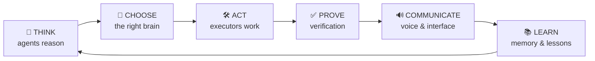
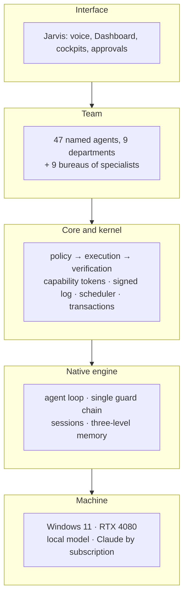
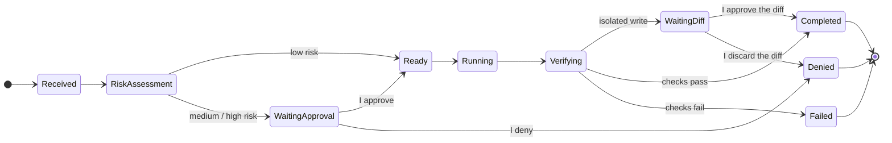

<b>English</b> · <a href="../fr/conception.md">Français</a> · <a href="../../README.md">← Back</a>

# Design & architecture

How I thought about OS-Agentique and how it works today, without going too deep into the code. State as of 4 November 2026.

## 1. The problem I wanted to solve

I wanted AI agents doing real work on my machine: writing code, preparing documents, searching for a job, supporting security work, then running a store. But I did not want to *hope* they would behave. I wanted to **know**, the way a manager knows what the team is doing.

That gave me three questions, and the whole system answers them:

1. **Who decides?** One director talks to me; departments do the work.
2. **What is allowed?** Every task gets a risk level; anything that can change something waits for me.
3. **How do I know it worked?** The result is verified, not assumed.

## 2. Six verbs

Early on, I organised the whole system around six verbs. Every component has exactly one role:

## 3. The layers: from a borrowed engine to my own

For six weeks, I built **around** an open-source engine, Hermes Agent (Nous Research). That was the right choice at the start: it spared me writing what already existed, and let me focus on the layer that turns a lone agent into a supervised team.

On 28 October, I removed it from the code (ADR-144). The story is in [How it was built](build-log.md#week-6--26-to-29-october-leaving-the-engine). The agent loop now lives in the repository. Hermes remains the director's name.

The engine knows two families of brains:

- **API**: my loop drives the model directly (Ollama locally, any OpenAI-compatible service, Anthropic by key).
- **Harness**: the Claude client (`claude -p`) runs the loop, and my tools are served to it by an MCP server. It starts with no native tool. If it exposes one at start-up, the turn is refused.

Either way, a tool call goes through the same function. Brains and engine are data: changing provider needs no code.

Each turn gets a **regime** decided by the code: conversation (8 turns, 20,000 context tokens), mission (12 turns, 32,000), workshop (40 turns, 48,000).

## 4. The life of a task

Every request, whether it comes from voice, keyboard or another agent, goes through **one single door**. There is no shortcut.

Four rules I never break:

- **Risk can only go up.** A task's risk is the highest of what is requested and what the task can *actually* do. Nobody, not even an agent, can declare a dangerous task "low" to avoid my approval.
- **An approval is bound to what I saw.** When I click "Approve", I approve *exactly that action*. If anything changes after my click, it is rejected.
- **A write is a transaction.** A task that changes code works in an isolated worktree. Its diff is shown to me, and only its fingerprint can be approved.
- **"Done" requires proof.** The system checks that the file exists, that the command succeeded and that nothing leaked, before closing the task.

## 5. Security in layers

I retrained in cybersecurity, so the system is designed like a defended network, with several independent barriers, so that one failure is not enough.

| Barrier | What it prevents |
|---|---|
| **Org chart** | only six workers can write; managers and the director read and delegate |
| **Risk policy + approval** | nothing that can change something runs without my click |
| **Capability token** | every tool call is checked before its effect, against a token signed by the kernel |
| **Single guard chain** | tool of the turn, schema, path, emergency stop, token, registry, output bound, secret masking: one path, for every brain |
| **Imported agents** | the 161 bureau specialists neither write nor execute, whatever their token; a modified file is refused at load time |
| **Never the web and my data together** | an agent reading the web never holds personal or named data: a malicious page cannot get them out |
| **The eye** | an attached image is read by an agent with no tools; the director receives a card, never the image |
| **Brain by data class** | the HR department and agents reading a named schedule only run on the local model or Claude, otherwise refused; the Red Team, Hugo, Hélène and Aurèle are locked to local |
| **Drift alerts** | automatic alerts if a task leaves its frame during execution |
| **Secret detector** | every backup is scanned; a password, a key or a real staff name blocks the commit |
| **Local only** | the interface only listens on the PC, never on the network |

**What is not a barrier, plainly stated.** Since ADR-144, everything runs under my Windows account: the separate `hermes-agents` account and its runner, tried in late October, were removed. A writing agent's terminal is bounded (duration, output, deny list), but that filter reads text: a command built at run time gets past it. **This is not operating-system isolation.** The real bound is the worktree and the diff I approve.

## 6. How I work: written decisions, required proof

- **148 architecture decisions (ADRs)** as of 4 November 2026. Each gives the context, the decision, the rejected alternatives and the *proof*. What is decided is written down, so the next session (human or AI) does not undo it.
- **A gate before each feature**: *What? Why? Interface? Security? Test? Rollback?*, answered **before** writing code.
- **Tests at three levels**: 3,293 unit tests green at the last full run (3 November, 1 skipped), 681 green Playwright runs, and 38 *contract test* files that check every external tool still behaves as expected.
- **A zero-tolerance security gate** for the engine: 36 cases out of 36, re-run after any change to the agent loop.
- **Deterministic first.** Anything mechanical is done by a plain script, not by an AI. The store schedule, for instance, is computed by code; agents review it.
- **Reproducible.** One command installs everything, with three profiles (desktop, laptop, server). An encrypted export handles a move. Proof on a blank machine remains to be done.

## 7. What I learned along the way

Honest lessons that shaped the design:

- **An AI can announce work without doing it.** Hermes once answered "I'm launching a search…" without calling a single tool. Since then, the interface shows every real step live, and states plainly when an action was only *announced*.
- **A written rule is not an enforced rule.** A cross-audit showed that my risk rule existed in the documentation but was not applied in one code path. I fixed it and wrote down the principle: a rule only counts if a test proves it.
- **The right model is not always the biggest.** I compared several local models on agent tasks. The one I kept scored 9/10.
- **A dependency can stop everything without warning.** An upstream engine update, combined with the team's growth, blocked every turn for several hours. I had put several workarounds in place; none fixed the cause.
- **"Delivered" must mean connected.** The first version of the Store was declared validated while several integrations were fake. A product audit showed it. The department's document now says what is done and what is not connected.

---

Next: [**Meet the team**](team.md) · [**A day with Hermes**](walkthrough.md) · [**Key decisions**](decisions.md)
