<b>English</b> · <a href="../fr/equipe.md">Français</a> · <a href="../../README.md">← Back</a>

# Meet the team

37 agents, organised like a company, in 8 departments. Each agent has an identity card (its “soul”) that sets its mission, its rules and whether it is allowed to write.

**The golden rule:** managers read, decide and delegate. Only designated workers (marked ✍️) are allowed to write, and even then only within the limits of an approved task.

```mermaid
flowchart TD
    H["<b>Hermes</b> · Director"]
    H --> DEV["<b>Ada</b> · Development"]
    H --> RH["<b>Nora</b> · HR & job search"]
    H --> SEC["<b>Alix</b> · Defensive security"]
    H --> RED["<b>Strike</b> · Red Team"]
    H --> TIK["<b>TIK</b> · Digital commerce"]
    H --> COM["<b>Victor</b> · Sales"]
    H --> SG["<b>Margot</b> · Back office"]
    H --> AUD["<b>Garance</b> · External audit"]
    H -.-> IR["<b>Iris</b> · Web navigator"]
    DEV --> A1["Architect"] & A2["Linus ✍️"] & A3["Grace"] & A4["Tester ✍️"] & A5["ISO auditor"]
    RH --> B1["Camille ✍️"] & B2["Sacha"] & B3["Léo"] & B4["Inès"] & B5["Basile"]
    SEC --> C1["Mira ✍️"] & C2["Elias"] & C3["Owen"]
    RED --> D1["Spectre ✍️"] & D2["Breach ✍️"] & D3["Aegis"]
    TIK --> E1["Noé"] & E2["Jules"] & E3["Lina"] & E4["Maya"] & E5["Hugo"] & E6["Clara"]
    COM --> G1["Théo"] & G2["Chloé"]
    SG --> F1["Hélène"] & F2["Aurèle"]
    AUD --> I1["Sable"]
```

---

## 🎯 Hermes, the director

My **only point of contact**. He listens (voice or keyboard), decides what needs doing, hands it to the right department and reports back. He never does the work himself, and he can only *read*: that keeps the most exposed agent, the one I talk to, also the least powerful.

---

## 💻 Development: Ada

| Agent | Role |
|---|---|
| **Ada** (manager) | turns a feature request into a plan and checks the result is complete and tested |
| **Architect** | designs the technical approach *before* anyone writes code |
| **Linus** ✍️ | writes and fixes the code; says exactly which files he touched |
| **Grace** | reviews changes: bugs, security flaws, missing tests, each ranked by severity. Never modifies anything |
| **Tester** ✍️ | runs the test suites and reports, without “fixing” anything to make them pass |
| **ISO auditor** | checks the project against the ISO 27001 security standard |

*The Architect, the Tester and the ISO auditor were designed by the system's own “agent factory”, then tested and approved by me before being activated.*

---

## 👥 HR & job search: Nora

| Agent | Role |
|---|---|
| **Nora** (manager) | runs the job search and CV work; when information is missing, she **asks me** instead of inventing it |
| **Léo** | watches public job boards every morning. He only knows the search criteria, **never** my personal data |
| **Inès** | scores each offer against my profile and discusses it with me. She reads my profile but has **no web access** |
| **Camille** ✍️ | analyses a job ad and writes a CV tailored to it, from real facts only |
| **Sacha** | reads the CV like a recruiter would: “does it pass the first screening, and why?” |
| **Basile** | career mentor: keeps a retraining roadmap (steps, certifications, weekly check-in). Every proposal is validated by me; his web research goes through Iris, on a closed list of sites |

*The split between Léo (web, no personal data) and Inès (personal data, no web) is deliberate: a malicious job ad can never trick an agent into leaking my information.*

---

## 🛡️ Defensive security: Alix

| Agent | Role |
|---|---|
| **Alix** (manager) | plans security work and **guards access** to my personal data across the whole system |
| **Mira** ✍️ | detection and incident response: analyses logs and alerts, writes detection rules and reports |
| **Elias** | compliance audits, read-only: ISO 27001, NIST, GDPR |
| **Owen** | prepares and documents penetration tests carried out by me: scope, rules of engagement, checklists, report templates |

*The department relies on a local library of 759 defensive guides (detection, forensics, incident response, hardening, compliance).*

---

## 🔴 Red Team: Strike

Adversary emulation, **for defensive purposes**, under strict supervision.

| Agent | Role |
|---|---|
| **Strike** (manager) | leads the cell and plans authorised engagements |
| **Spectre** ✍️ · **Breach** ✍️ | analysts supporting authorised security assessments; their write right only exists inside an approved task, “kernel only”: launched outside a task, they have no tool at all |
| **Aegis** | **ethics advisor**: reviews every plan for authorisation, scope, legality, proportionality and data protection. Advises only, never acts |

**Built-in safeguards:**
- every task in this department is **forced to the highest risk level**, whatever the request;
- it therefore **always waits for my manual approval**; the “Auto” mode can never approve it;
- a real action is always a gesture I perform myself, on a target I am authorised to test.

---

## 🛒 Digital commerce: TIK

A **full product department** to build and run a real website.

| Agent | Role |
|---|---|
| **TIK** (manager) | leads the department, frames missions and budgets |
| **Noé** | site designer; proposes mock-ups, does not write in the site repository |
| **Jules** | web writer, with no web access: he writes from the facts sourced by the mission; the article is written by code, on a branch |
| **Lina** | SEO analyst |
| **Maya** | market researcher |
| **Hugo** | website infrastructure analyst |
| **Clara** | legal: legal groundwork, compliance |

*A strict “web ⊕ privilege” boundary: an agent has the web **or** a server privilege, never both in the same move. Every fact is sourced; a publication cap bounds what can go live.*

---

## 🗂️ Secretariat: Margot

| Agent | Role |
|---|---|
| **Margot** (manager) | recurring admin work (invoices, documents); exposes aggregates only |
| **Hélène** | archivist: local read of documents, only |
| **Aurèle** | post-mortems: fixed-format incident reports, generated by code from the registry, validated by me |

*In real conditions since October: documents are collected from the mailbox by a browser extension (code, not an agent), each document is read locally, filed in the Drive by rules, and every doubtful case lands “for my attention”. The director never sees a document, a name or an amount: only counts.*

---

## 📞 Sales: Victor

A **real sales mission** (a local gift card): recruiting shops that accept it, selling batches to buyers.

| Agent | Role |
|---|---|
| **Victor** (manager) | runs the department and writes the summary; only ever sees counts |
| **Théo** | prospector: scouts shops and organisations on the public web, **never receives nor collects contact details** |
| **Chloé** | copilot: prepares calls, visits and messages, **without web** |

*The CRM, follow-ups and the daily plan are code, not an agent. An e-mail draft can be prepared; **nothing is ever sent by the system**, I send it myself. An opt-out is a flag checked on every solicitation path.*

---

## 🔎 External audit: Garance

**Passive** public-exposure reviews (public pages, certificates, registries), on my own assets or under written mandate.

| Agent | Role |
|---|---|
| **Garance** (manager) | frames the missions; the scope is a file I write myself |
| **Sable** | passive reconnaissance: reads public sources, never the browser nor the terminal |

*Every finding is validated by code against the reading log: a finding without evidence is rejected. Elias (security department) gives a compliance opinion per mission.*

---

## 🧭 Iris, the web navigator

The **only** agent allowed to drive a browser, always **in the operator's sight** and behind a deterministic guard. Isolating browsing in a single, watched agent keeps a booby-trapped page from hijacking the rest of the team.

---

## 🤝 Coworking

Not an agent but a **shared workspace**: I set a goal, the team works on it, and I follow a readable activity feed, answer questions and approve steps. Its log is chained with fingerprints, so any tampering is detected.

---

Next: [**A day with Hermes**](walkthrough.md) · [**Design & architecture**](design.md) · [**Key decisions**](decisions.md)
