<b>English</b> · <a href="../fr/equipe.md">Français</a> · <a href="../../README.md">← Back</a>

# Meet the team

217 agents in total, organised like a company: **47 named agents** across **9 departments** and three separate roles (the forge, Iris, Lucie), plus **9 bureaus** grouping 161 specialists and their 9 managers. Each agent has an identity card (its "soul") that sets its mission, its rules and whether it is allowed to write.

**The golden rule:** managers read, decide and delegate. Only six workers (marked ✍️) are allowed to write, and even then only within the limits of an approved task.

```mermaid
flowchart TD
    H["<b>Hermes</b> · Director"]
    H --> DEV["<b>Ada</b> · Development"]
    H --> RH["<b>Nora</b> · HR & job search"]
    H --> SEC["<b>Alix</b> · Defensive security"]
    H --> RED["<b>Strike</b> · Red Team"]
    H --> TIK["<b>TIK</b> · Digital commerce"]
    H --> COM["<b>Victor</b> · Sales"]
    H --> MAG["<b>Odilon</b> · Store"]
    H --> SG["<b>Margot</b> · Back office"]
    H --> AUD["<b>Garance</b> · External audit"]
    H -.-> IR["<b>Iris</b> · Web navigator"]
    H -.-> OE["<b>Lucie</b> · The eye"]
    H -.-> FO["<b>Anselme</b> · The forge"]
    H -.-> BU["<b>9 bureaus</b> · 161 specialists"]
    DEV --> A1["Architect"] & A2["Linus ✍️"] & A3["Grace"] & A4["Tester ✍️"] & A5["ISO auditor"]
    RH --> B1["Camille ✍️"] & B2["Sacha"] & B3["Léo"] & B4["Inès"] & B5["Basile"]
    SEC --> C1["Mira ✍️"] & C2["Elias"] & C3["Owen"]
    RED --> D1["Spectre ✍️"] & D2["Breach ✍️"] & D3["Aegis"]
    TIK --> E1["Noé"] & E2["Jules"] & E3["Lina"] & E4["Maya"] & E5["Hugo"] & E6["Clara"]
    COM --> G1["Théo"] & G2["Chloé"]
    MAG --> M1["Thomas"] & M2["Claire"] & M3["Lucas"] & M4["Émilie"] & M5["Ombeline"]
    SG --> F1["Hélène"] & F2["Aurèle"]
    AUD --> I1["Sable"]
    FO --> J1["Colin"] & J2["Honorine"]
```

---

## 🎯 Hermes, the director

My **only point of contact**. It listens (voice or keyboard), decides what needs doing, hands it to the right department and reports back. It never does the work itself, and it can only *read*: that keeps the most exposed agent, the one I talk to, also the least powerful.

Hermes was also the name of the open-source engine the project started on. That engine was removed on 28 October; the director kept the name.

---

## 💻 Development: Ada

| Agent | Role |
|---|---|
| **Ada** (manager) | turns a request into a plan and checks that the result is complete and tested |
| **Architect** | designs the technical approach *before* anyone writes code |
| **Linus** ✍️ | writes and fixes code; states exactly which files were touched |
| **Grace** | reviews changes: bugs, flaws, missing tests, ranked by severity. Never modifies anything |
| **Tester** ✍️ | runs the tests and reports, without "fixing" anything to make them pass |
| **ISO auditor** | checks the project against the ISO 27001 security standard |

*The Architect, the Tester and the ISO auditor were designed by the system's own "agent factory", then tested and validated by me before activation.*

---

## 👥 HR & job search: Nora

| Agent | Role |
|---|---|
| **Nora** (manager) | runs the job search and CV work; when information is missing, it **asks me** rather than making it up |
| **Léo** | watches public job offers. It only knows the search criteria, **never** my personal data |
| **Inès** | scores each offer against my profile and discusses it with me. It reads my profile but has **no web access** |
| **Camille** ✍️ | analyses a job ad and writes a tailored CV, only from real facts |
| **Sacha** | reads the CV as a recruiter would: "does it pass the first screen, and why?" |
| **Basile** | career coach: objective plan, assumptions to confirm, "This week" card, skills, quizzes, mock interview, monthly review. I validate every proposal; official links are checked by code before reaching me |

*The split between Léo (the web, no personal data) and Inès (personal data, no web) is deliberate: a malicious job ad can never lead an agent to disclose my information. The department only runs on the local model or Claude, and does not consult the bureaus.*

---

## 🛡️ Defensive security: Alix

| Agent | Role |
|---|---|
| **Alix** (manager) | plans security work and **guards access** to my personal data across the system |
| **Mira** ✍️ | detection and incident response: analyses logs and alerts, writes detection rules and reports |
| **Elias** | compliance audits, read-only: ISO 27001, NIST, GDPR |
| **Owen** | prepares and documents the penetration tests I run: scope, rules of engagement, checklists, report templates |

*The department relies on a local library of 759 defensive guides (detection, forensics, incident response, hardening, compliance).*

---

## 🔴 Red Team: Strike

Adversary emulation, **for defensive purposes**, under strict supervision.

| Agent | Role |
|---|---|
| **Strike** (manager) | leads the cell and plans authorised missions |
| **Spectre** ✍️ · **Breach** ✍️ | analysts supporting authorised security assessments; their write right only exists inside an approved task, "kernel only": started outside a task, they have no tools |
| **Aegis** | **ethics advisor**: reviews each plan for authorisation, scope, legality, proportionality and data protection. It advises, never acts |

**Built-in safeguards:**
- every task in this department is **forced to the highest risk level**, whatever the request;
- it therefore **always waits for my manual approval**; "Auto" mode can never approve it;
- the department is **locked to the local brain** by a sealed policy;
- a real action is always something I perform myself, on a target I am authorised to test;
- the authorised scope is a file that **only I** write; the director can only propose a real programme I gave it, and **never** a mission: this department cannot be delegated to.

---

## 🛒 Digital commerce: TIK

A **complete product department** to build and run a real website.

| Agent | Role |
|---|---|
| **TIK** (manager) | runs the department, frames missions and budgets |
| **Noé** | site designer; proposes mock-ups, does not write to the site repository |
| **Jules** | web writer, with no web access: writes from the facts sourced by the mission; the article is written by code, on a branch |
| **Lina** | SEO analyst |
| **Maya** | market researcher |
| **Hugo** | site infrastructure analyst, locked to the local brain |
| **Clara** | legal: legal base, compliance |

*Strict "web ⊕ privilege" boundary: an agent has the web **or** a server privilege, never both in the same action. Every fact is sourced; a publication cap limits what can go online.*

---

## 🏪 Store: Odilon

**Running a local food shop**, inside the Sales cockpit. Six agents, all **read-only**: they propose and review, and I apply in Jarvis.

| Agent | Role |
|---|---|
| **Odilon** (manager) | my contact for the store: reads the whole department, hands work to its team, never has the web |
| **Thomas** | scheduler: adjusts the schedule proposed by code |
| **Claire** | auditor: reviews the schedule against labour law and the sector's collective agreement |
| **Lucas** | reconciles delivery notes and invoices, from statements exported from the store management software |
| **Émilie** | tracks the safety register, maintenance and the HACCP register |
| **Ombeline** | local watch, weather, customer reviews. It has the web, and **no staff data** |

*The schedule and sales per paid hour (VHP) are computed by code, not by an agent. A schedule is only validated by my action, with no blocking alert. Agents reading a named schedule have no web and only run on the local model or Claude. No real staff data is in the repository; the checkpoint blocks real names.*

---

## 🗂️ Back office: Margot

| Agent | Role |
|---|---|
| **Margot** (manager) | recurring administrative tasks (invoices, documents); only exposes aggregates |
| **Hélène** | archivist: local reading of documents only. Locked to the local brain |
| **Aurèle** | post-mortems: incident reports in a fixed format, generated by code from the register, validated by me. Locked to the local brain |

*In real conditions since October: collecting documents from the mailbox is done by a browser extension (code, not an agent), each document is read locally, filed in Drive by rules, and any doubtful case comes "to my attention". The director never sees a document, a name or an amount: only counts.*

---

## 📞 Sales: Victor

A **real sales mission** (a local gift card): recruit shops that accept it, sell batches to buyers.

| Agent | Role |
|---|---|
| **Victor** (manager) | runs the department and writes the summary; only sees counts |
| **Théo** | prospector: spots shops and organisations on the public web, **never receives or collects contact details** |
| **Chloé** | co-pilot: prepares calls, visits and messages, **with no web** |

*The CRM, follow-ups and the daily plan are code, not an agent. An email draft can be prepared; **nothing is ever sent by the system**, I send it. An opt-out is a flag checked on every outreach path.*

---

## 🔎 External audit: Garance

**Passive** public-exposure reviews (public pages, certificates, registries), on my own assets or under written mandate.

| Agent | Role |
|---|---|
| **Garance** (manager) | frames missions; the scope is a file I write myself |
| **Sable** | passive reconnaissance: reads public sources, never the browser or the terminal |

*Each finding is validated by code against the reading log: a finding without proof is rejected. Elias (security department) gives a compliance opinion per mission.*

---

## 🧭 Iris, the web navigator

The **only** agent allowed to drive a browser, always **in the operator's sight** and behind a deterministic safeguard. Isolating browsing in one watched agent keeps a malicious page from hijacking the rest of the team.

---

## 👁️ Lucie, the eye

It reads the images I attach to a conversation, **with no tools**, and returns a card in an enforced format. The director receives the card as untrusted data, never the image: text hidden in a screenshot does not become an instruction.

---

## ⚒️ The forge: Anselme

Three agents **with no tools**, orchestrated by code, to produce prompts and skills scored on test cases.

| Agent | Role |
|---|---|
| **Anselme** (manager) | writes the test cases, then each version of the candidate |
| **Colin** | plays the candidate on each case; its output is data |
| **Honorine** | judge: scores each output on a fixed grid, without seeing earlier scores |

*Code decides and always adds at least one injection case. The best candidate waits for my review and lands as a draft; nothing is deployed on its own.*

---

## 🏢 The agent bureaus

Nine bureaus of specialists, like the services of a company. The 161 agents come from an open-source library ([VoltAgent](https://github.com/VoltAgent/awesome-claude-code-subagents), MIT licence), imported by a deterministic program from a pinned source. Each received a first name and a short card. The managers are written by hand.

| Bureau | Manager | What it covers | Agents |
|---|---|---|---|
| **Technical** | Bastien | architecture, API, front end, back end, mobile, tooling | 29 |
| **Languages** | Coline | one specialist per language or framework | 30 |
| **Operations** | Damien | cloud, containers, network, SRE, incidents, Windows server | 16 |
| **Quality & security** | Estelle | code review, tests, debugging, performance, accessibility, compliance (defensive advice) | 17 |
| **Data & AI** | Fabien | data analysis and engineering, ML, LLMs, prompts, databases | 13 |
| **Specialised trades** | Gaëlle | fintech, payment, health, IoT, games, M365, SEO, risk | 16 |
| **Product & business** | Hélio | product, project, agile, marketing, legal, UX | 18 |
| **Organisation** | Isaure | coordination, workflows, memory, synthesis | 11 |
| **Research & analysis** | Joachim | desk research, watch, market, competition | 11 |

**How it works:** I hand a request to a bureau, or the director and department agents do. Code preselects candidates, the manager picks and sets the criteria, the agent works, the manager checks. In the clear-cut case, code picks alone and one mission in five is reviewed.

**What they cannot do:** write, execute, delegate or memorise on their own, whatever their token. Only the research bureau has the web. A modified agent file is refused at load time. Private HR and External audit do not consult them. The source's penetration-testing prompt was not imported.

---

## 🤝 Coworking

Not an agent but a **shared workshop**: I set a goal, the team works on it, and I follow a readable activity feed, answer questions and approve steps. Its log is chained by fingerprints: any tampering is detected.

---

Next: [**A day with Hermes**](walkthrough.md) · [**Design & architecture**](design.md) · [**Key decisions**](decisions.md)
