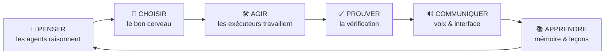
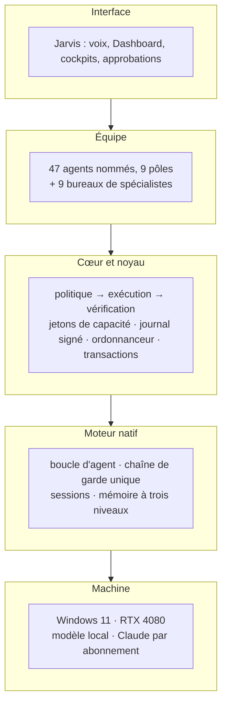
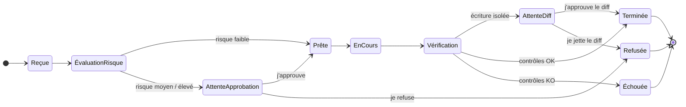

<a href="../en/design.md">English</a> · <b>Français</b> · <a href="../../README.fr.md">← Retour</a>

# Conception & architecture

Comment j'ai pensé OS-Agentique et comment il fonctionne aujourd'hui, sans trop entrer dans le code. État au 4 novembre 2026.

## 1. Le problème que je voulais résoudre

Je voulais des agents IA qui font du vrai travail sur ma machine : écrire du code, préparer des documents, chercher un emploi, appuyer le travail de sécurité, puis faire tourner un magasin. Mais je ne voulais pas *espérer* qu'ils se comportent bien. Je voulais **savoir**, comme un manager sait ce que fait son équipe.

Cela m'a donné trois questions, et tout le système y répond :

1. **Qui décide ?** Un seul directeur me parle ; les pôles font le travail.
2. **Qu'est-ce qui est permis ?** Chaque tâche reçoit un niveau de risque ; tout ce qui peut modifier quelque chose m'attend.
3. **Comment je sais que ça a marché ?** Le résultat est vérifié, pas supposé.

## 2. Six verbes

Très tôt, j'ai organisé tout le système autour de six verbes. Chaque composant a exactement un rôle :

## 3. Les étages : d'un moteur emprunté à un moteur à moi

Pendant six semaines, j'ai construit **autour** d'un moteur open source, Hermes Agent (Nous Research). C'était le bon choix au départ : il m'a évité d'écrire ce qui existait déjà, et m'a laissé me concentrer sur la couche qui transforme un agent isolé en équipe supervisée.

Le 28 octobre, je l'ai retiré du code (ADR-144). Le récit est dans [Comment ça a été construit](construction.md#semaine-6--26-au-29-octobre--sortir-du-moteur). La boucle d'agent est maintenant dans le dépôt. Jarod reste le nom du directeur.

Le moteur connaît deux familles de cerveaux :

- **API** : ma boucle pilote directement le modèle (Ollama en local, tout service compatible OpenAI, Anthropic par clé).
- **Harnais** : le client Claude (`claude -p`) fait la boucle, et mes outils lui sont servis par un serveur MCP. Il est lancé sans aucun outil natif. S'il en expose un au démarrage, le tour est refusé.

Dans les deux cas, un appel d'outil passe par la même fonction. Cerveaux et moteur sont des données : changer de fournisseur ne demande pas de code.

Chaque tour reçoit un **régime** décidé par le code : conversation (8 tours, 20 000 jetons de contexte), mission (12 tours, 32 000), atelier (40 tours, 48 000).

## 4. La vie d'une tâche

Chaque demande, qu'elle vienne de la voix, du clavier ou d'un autre agent, passe par **une seule porte**. Il n'y a pas de raccourci.

Quatre règles que je ne transgresse jamais :

- **Le risque ne peut que monter.** Le risque d'une tâche est le plus élevé entre ce qui est demandé et ce que la tâche peut *réellement* faire. Personne, pas même un agent, ne peut déclarer « faible » une tâche dangereuse pour éviter mon approbation.
- **Une approbation est liée à ce que j'ai vu.** Quand je clique sur « Approuver », j'approuve *exactement cette action*. Si quoi que ce soit change après mon clic, elle est rejetée.
- **Une écriture est une transaction.** Une tâche qui modifie du code travaille dans un worktree isolé. Son diff m'est présenté, et seule son empreinte peut être approuvée.
- **« Terminé » exige une preuve.** Le système vérifie que le fichier existe, que la commande a réussi et que rien n'a fuité, avant de clore la tâche.

## 5. Une sécurité en couches

Je me suis reconverti vers la cybersécurité : le système est donc conçu comme un réseau défendu, avec plusieurs barrières indépendantes, pour qu'une seule défaillance ne suffise pas.

| Barrière | Ce qu'elle empêche |
|---|---|
| **Organigramme** | seuls six exécutants peuvent écrire ; managers et directeur lisent et délèguent |
| **Politique de risque + approbation** | rien de ce qui peut modifier quelque chose ne s'exécute sans mon clic |
| **Jeton de capacité** | chaque appel d'outil est contrôlé avant son effet, contre un jeton signé par le noyau |
| **Chaîne de garde unique** | outil du tour, schéma, chemin, arrêt d'urgence, jeton, registre, borne de sortie, masque des secrets : un seul chemin, pour tous les cerveaux |
| **Agents importés** | les 161 spécialistes des bureaux n'écrivent ni n'exécutent, quel que soit leur jeton ; un fichier modifié est refusé au chargement |
| **Jamais le web et mes données ensemble** | un agent qui lit le web ne détient jamais de données personnelles ou nominatives : une page piégée ne peut pas les faire sortir |
| **L'œil** | une image jointe est lue par un agent sans outil ; le directeur reçoit une fiche, jamais l'image |
| **Cerveau par donnée** | le pôle RH et les agents qui lisent un planning nominatif ne tournent que sur le modèle local ou Claude, refus sinon ; la Red Team, Hugo, Hélène et Aurèle sont verrouillés en local |
| **Alertes de dérive** | alertes automatiques si une tâche sort de son cadre pendant l'exécution |
| **Détecteur de secrets** | chaque sauvegarde est analysée ; un mot de passe, une clé ou un nom réel de l'équipe bloque le commit |
| **Local uniquement** | l'interface n'écoute que sur le PC, jamais sur le réseau |

**Ce qui n'est pas une barrière, dit franchement.** Depuis l'ADR-144, tout tourne sous mon compte Windows : le compte séparé `hermes-agents` et son runner, essayés fin octobre, ont été retirés. Le terminal d'un agent écrivain est borné (durée, sortie, liste de refus), mais ce filtre lit du texte : une commande construite à l'exécution le contourne. **Ce n'est pas une isolation du système d'exploitation.** La borne réelle est le worktree et le diff que j'approuve.

## 6. Ma façon de travailler : décisions écrites, preuves exigées

- **148 décisions d'architecture (ADR)** au 4 novembre 2026. Chacune précise le contexte, la décision, les alternatives écartées et la *preuve*. Ce qui est décidé est écrit, pour que la session suivante (humaine ou IA) ne le défasse pas.
- **Un sas avant chaque fonctionnalité** : *Quoi ? Pourquoi ? Interface ? Sécurité ? Test ? Retour arrière ?*, avec une réponse **avant** d'écrire le code.
- **Des tests à trois niveaux** : 3 293 tests unitaires verts à la dernière passe complète (3 novembre, 1 ignoré), 681 passages Playwright verts, et 38 fichiers de *tests de contrat* qui vérifient que chaque outil externe se comporte toujours comme prévu.
- **Une porte de sécurité à zéro tolérance** pour le moteur : 36 cas sur 36, à relancer après toute modification de la boucle d'agent.
- **Le déterministe d'abord.** Ce qui est mécanique est fait par un simple script, pas par une IA. Le planning du magasin, par exemple, est calculé par du code ; les agents le relisent.
- **Reproductible.** Une commande installe tout, avec trois profils (fixe, portable, serveur). Un export chiffré sert au déménagement. La preuve sur une machine vierge reste à faire.

## 7. Ce que j'ai appris en route

Des leçons honnêtes qui ont façonné la conception :

- **Une IA peut annoncer un travail sans le faire.** Jarod a un jour répondu « Je lance une recherche… » sans appeler le moindre outil. Depuis, l'interface montre chaque étape réelle en direct, et dit explicitement quand une action a seulement été *annoncée*.
- **Une règle écrite n'est pas une règle appliquée.** Un audit croisé a montré que ma règle de risque existait dans la documentation mais n'était pas appliquée dans un chemin du code. Je l'ai corrigée, et j'ai écrit le principe : une règle ne compte que si un test la prouve.
- **Le bon modèle n'est pas toujours le plus gros.** J'ai comparé plusieurs modèles locaux sur des tâches d'agent. Celui que j'ai retenu a obtenu 9/10.
- **Une dépendance peut tout arrêter sans prévenir.** Une mise à jour du moteur amont, combinée à la croissance de l'équipe, a bloqué tous les tours pendant plusieurs heures. J'avais posé plusieurs parades ; aucune ne réglait la cause.
- **« Livré » doit vouloir dire branché.** La première version du Magasin a été déclarée validée alors que plusieurs intégrations étaient factices. Un audit produit l'a montré. Le document du pôle dit depuis ce qui est fait et ce qui n'est pas branché.

---

Suite : [**L'équipe**](equipe.md) · [**Une journée avec Jarod**](parcours.md) · [**Décisions clés**](decisions.md)
