<a href="../en/team.md">English</a> · <b>Français</b> · <a href="../../README.fr.md">← Retour</a>

# L'équipe

217 agents au total, organisés comme une entreprise : **47 agents nommés** répartis en **9 pôles** et trois rôles à part (la forge, Iris, Lucie), plus **9 bureaux** qui regroupent 161 spécialistes et leurs 9 managers. Chaque agent a une carte d'identité (son « âme ») qui fixe sa mission, ses règles et s'il a le droit d'écrire.

**La règle d'or :** les managers lisent, décident et délèguent. Seuls six exécutants (marqués ✍️) ont le droit d'écrire, et uniquement dans les limites d'une tâche approuvée.

```mermaid
flowchart TD
    H["<b>Jarod</b> · Directeur"]
    H --> DEV["<b>Ada</b> · Développement"]
    H --> RH["<b>Nora</b> · RH & emploi"]
    H --> SEC["<b>Alix</b> · Sécurité défensive"]
    H --> RED["<b>Strike</b> · Red Team"]
    H --> TIK["<b>TIK</b> · Commerce digital"]
    H --> COM["<b>Victor</b> · Commercial"]
    H --> MAG["<b>Odilon</b> · Magasin"]
    H --> SG["<b>Margot</b> · Secrétariat"]
    H --> AUD["<b>Garance</b> · Audit externe"]
    H -.-> IR["<b>Iris</b> · Navigatrice web"]
    H -.-> OE["<b>Lucie</b> · L'œil"]
    H -.-> FO["<b>Anselme</b> · La forge"]
    H -.-> BU["<b>9 bureaux</b> · 161 spécialistes"]
    DEV --> A1["Architecte"] & A2["Linus ✍️"] & A3["Grace"] & A4["Testeur ✍️"] & A5["Auditeur ISO"]
    RH --> B1["Camille ✍️"] & B2["Sacha"] & B3["Léo"] & B4["Inès"] & B5["Basile"]
    SEC --> C1["Mira ✍️"] & C2["Elias"] & C3["Owen"]
    RED --> D1["Spectre ✍️"] & D2["Breach ✍️"] & D3["Aegis"]
    TIK --> E1["Noé"] & E2["Jules"] & E3["Lina"] & E4["Maya"] & E5["Hugo"] & E6["Clara"]
    COM --> G1["Théo"] & G2["Chloé"]
    MAG --> M1["Thomas"] & M2["Claire"] & M3["Lucas"] & M4["Émilie"] & M5["Ombeline"]
    SG --> F1["Hélène"] & F2["Aurèle"]
    AUD --> I1["Sable"]
    FO --> J1["Colin"] & J2["Honorine"]
```

---

## 🎯 Jarod, le directeur

Mon **seul interlocuteur**. Il écoute (voix ou clavier), décide de ce qu'il faut faire, confie le travail au bon pôle et me rend compte. Il ne fait jamais le travail lui-même et ne peut que *lire* : l'agent le plus exposé, celui à qui je parle, est aussi le moins puissant.

Il s'appelait d'abord Hermes, comme le moteur open source sur lequel le projet a démarré. Ce moteur a été retiré le 28 octobre, et le directeur a pris un nom à lui : Jarod.

---

## 💻 Développement : Ada

| Agent | Rôle |
|---|---|
| **Ada** (manager) | transforme une demande en plan et vérifie que le résultat est complet et testé |
| **Architecte** | conçoit l'approche technique *avant* que quiconque écrive du code |
| **Linus** ✍️ | écrit et corrige le code ; indique précisément les fichiers touchés |
| **Grace** | relit les changements : bugs, failles, tests manquants, classés par gravité. Ne modifie jamais rien |
| **Testeur** ✍️ | lance les tests et rapporte, sans rien « corriger » pour les faire passer |
| **Auditeur ISO** | contrôle le projet au regard de la norme de sécurité ISO 27001 |

*L'Architecte, le Testeur et l'Auditeur ISO ont été conçus par la propre « usine à agents » du système, puis testés et validés par moi avant leur activation.*

---

## 👥 RH & emploi : Nora

| Agent | Rôle |
|---|---|
| **Nora** (manager) | pilote la recherche d'emploi et le travail sur le CV ; quand une information manque, elle **me la demande** au lieu de l'inventer |
| **Léo** | fait la veille des offres publiques. Il ne connaît que les critères de recherche, **jamais** mes données personnelles |
| **Inès** | note chaque offre au regard de mon profil et en discute avec moi. Elle lit mon profil mais n'a **aucun accès au web** |
| **Camille** ✍️ | analyse une annonce et rédige un CV adapté, uniquement à partir de faits réels |
| **Sacha** | lit le CV comme un recruteur : « passe-t-il le premier tri, et pourquoi ? » |
| **Basile** | coach carrière : plan d'objectifs, hypothèses à confirmer, carte « Cette semaine », compétences, quiz, entretien blanc, revue du mois. Chaque proposition est validée par moi ; les liens officiels sont vérifiés par le code avant de m'être soumis |

*La séparation entre Léo (le web, sans données personnelles) et Inès (les données personnelles, sans le web) est voulue : une annonce piégée ne peut jamais amener un agent à divulguer mes informations. Le pôle ne tourne que sur le modèle local ou Claude, et ne consulte pas les bureaux.*

---

## 🛡️ Sécurité défensive : Alix

| Agent | Rôle |
|---|---|
| **Alix** (manager) | planifie le travail de sécurité et **garde l'accès** à mes données personnelles dans tout le système |
| **Mira** ✍️ | détection et réponse à incident : analyse journaux et alertes, écrit des règles de détection et des rapports |
| **Elias** | audits de conformité, en lecture seule : ISO 27001, NIST, RGPD |
| **Owen** | prépare et documente les tests d'intrusion que je mène : périmètre, règles d'engagement, checklists, trames de rapport |

*Le pôle s'appuie sur une bibliothèque locale de 759 guides défensifs (détection, forensique, réponse à incident, durcissement, conformité).*

---

## 🔴 Red Team : Strike

Émulation d'adversaire, **à visée défensive**, sous supervision stricte.

| Agent | Rôle |
|---|---|
| **Strike** (manager) | dirige la cellule et planifie les missions autorisées |
| **Spectre** ✍️ · **Breach** ✍️ | analystes en appui des évaluations de sécurité autorisées ; leur droit d'écriture n'existe que dans une tâche approuvée, « noyau seulement » : lancés hors tâche, ils n'ont aucun outil |
| **Aegis** | **conseiller éthique** : relit chaque plan sous l'angle de l'autorisation, du périmètre, de la légalité, de la proportionnalité et de la protection des données. Il conseille, n'agit jamais |

**Garde-fous intégrés :**
- toute tâche de ce pôle est **forcée au niveau de risque maximal**, quelle que soit la demande ;
- elle **attend donc toujours mon approbation manuelle** ; le mode « Auto » ne peut jamais l'approuver ;
- le pôle est **verrouillé sur le cerveau local** par une politique scellée ;
- une action réelle est toujours un geste que j'accomplis moi-même, sur une cible que j'ai l'autorisation de tester ;
- le périmètre autorisé est un fichier que **moi seul** écris ; le directeur ne peut que proposer un programme réel que je lui ai donné, et **jamais** une mission : le pôle ne se délègue pas.

---

## 🛒 Commerce digital : TIK

Un **pôle produit complet** pour construire et faire vivre un vrai site.

| Agent | Rôle |
|---|---|
| **TIK** (manager) | pilote le pôle, cadre les missions et les budgets |
| **Noé** | designer du site ; propose des maquettes, n'écrit pas dans le dépôt du site |
| **Jules** | rédacteur web, sans accès au web : il écrit à partir des faits sourcés par la mission ; l'article est écrit par le code, sur une branche |
| **Lina** | analyste SEO |
| **Maya** | chargée d'études de marché |
| **Hugo** | analyste d'infrastructure du site, verrouillé sur le cerveau local |
| **Clara** | juriste : socle légal, conformité |

*Frontière stricte « web ⊕ privilège » : un agent a le web **ou** un privilège serveur, jamais les deux dans le même geste. Chaque fait est sourcé ; un plafond de publication borne ce qui peut partir en ligne.*

---

## 🏪 Magasin : Odilon

L'**exploitation d'un commerce alimentaire de proximité**, dans le cockpit Commercial. Six agents, tous en **lecture seule** : ils proposent et relisent, c'est moi qui applique dans Jarvis.

| Agent | Rôle |
|---|---|
| **Odilon** (manager) | mon interlocuteur pour le magasin : il lit tout le pôle, confie le travail à son équipe, n'a jamais le web |
| **Thomas** | planificateur : retouche le planning proposé par le code |
| **Claire** | auditrice : relit le planning au regard du Code du travail et de la convention collective du secteur |
| **Lucas** | rapproche les bons de livraison et les factures, à partir de relevés exportés du logiciel de gestion du magasin |
| **Émilie** | suit le registre de sécurité, la maintenance et le registre HACCP |
| **Ombeline** | veille locale, météo, avis clients. Elle a le web, et **aucune donnée d'équipe** |

*Le planning et la vente par heure payée (VHP) sont calculés par du code, pas par un agent. Un planning ne se valide que par mon geste, sans alerte bloquante. Les agents qui lisent un planning nominatif n'ont pas le web et ne tournent que sur le modèle local ou Claude. Aucune donnée réelle de l'équipe n'est dans le dépôt ; le checkpoint bloque les noms réels.*

---

## 🗂️ Secrétariat : Margot

| Agent | Rôle |
|---|---|
| **Margot** (manager) | tâches administratives récurrentes (factures, pièces) ; n'expose que des agrégats |
| **Hélène** | archiviste : lecture locale des pièces, uniquement. Verrouillée sur le cerveau local |
| **Aurèle** | post-mortems : rapports d'incident au format fixe, générés par le code à partir du registre, validés par moi. Verrouillé sur le cerveau local |

*En conditions réelles depuis octobre : la collecte des pièces dans la messagerie est faite par une extension de navigateur (du code, pas un agent), chaque pièce est lue en local, classée dans le Drive selon des règles, et tout cas douteux arrive « à mon attention ». Le directeur ne voit jamais une pièce, un nom ni un montant : seulement des comptes.*

---

## 📞 Commercial : Victor

Une **mission commerciale réelle** (une carte cadeau locale) : recruter des commerces qui l'acceptent, vendre des lots à des acheteurs.

| Agent | Rôle |
|---|---|
| **Victor** (manager) | pilote le pôle et rédige la synthèse ; ne voit que des comptes |
| **Théo** | prospecteur : repère des commerces et organisations sur le web public, **ne reçoit ni ne collecte jamais une coordonnée** |
| **Chloé** | copilote : prépare appels, visites et messages, **sans web** |

*Le CRM, les relances et le plan du jour sont du code, pas un agent. Un brouillon d'e-mail peut être préparé ; **rien n'est jamais envoyé par le système**, c'est moi qui envoie. Une opposition est un drapeau vérifié sur tout chemin de sollicitation.*

---

## 🔎 Audit externe : Garance

Des revues d'exposition publique **passives** (pages publiques, certificats, registres), sur mes propres actifs ou sous mandat écrit.

| Agent | Rôle |
|---|---|
| **Garance** (manager) | cadre les missions ; le périmètre est un fichier que j'écris moi-même |
| **Sable** | reconnaissance passive : lit des sources publiques, jamais le navigateur ni le terminal |

*Chaque constat est validé par le code contre le journal des lectures : un constat sans preuve est rejeté. Elias (pôle sécurité) donne un avis de conformité par mission.*

---

## 🧭 Iris, la navigatrice web

Le **seul** agent autorisé à piloter un navigateur, toujours **à la vue de l'opérateur** et derrière un garde-fou déterministe. Isoler la navigation dans un seul agent surveillé évite qu'une page piégée ne détourne le reste de l'équipe.

---

## 👁️ Lucie, l'œil

Elle lit les images que je joins à une conversation, **sans aucun outil**, et rend une fiche au format imposé. Le directeur reçoit la fiche comme une donnée non fiable, jamais l'image : un texte caché dans une capture ne devient pas une consigne.

---

## ⚒️ La forge : Anselme

Trois agents **sans aucun outil**, orchestrés par du code, pour produire des prompts et des skills notés sur des cas de test.

| Agent | Rôle |
|---|---|
| **Anselme** (manager) | écrit les cas de test, puis chaque version du candidat |
| **Colin** | joue le candidat sur chaque cas ; sa sortie est une donnée |
| **Honorine** | juge : note chaque sortie sur une grille fixe, sans voir les notes précédentes |

*Le code décide et ajoute toujours au moins un cas d'injection. Le meilleur candidat attend ma relecture et se dépose en brouillon ; rien n'est déployé seul.*

---

## 🏢 Les bureaux d'agents

Neuf bureaux de spécialistes, à la façon des services d'une entreprise. Les 161 agents viennent d'une bibliothèque open source ([VoltAgent](https://github.com/VoltAgent/awesome-claude-code-subagents), licence MIT), importée par un programme déterministe depuis une source épinglée. Chacun a reçu un prénom et une fiche courte. Les managers, eux, sont écrits à la main.

| Bureau | Manager | Ce qu'il couvre | Agents |
|---|---|---|---|
| **Technique** | Bastien | architecture, API, front, back, mobile, outillage | 29 |
| **Langages** | Coline | un spécialiste par langage ou framework | 30 |
| **Exploitation** | Damien | cloud, conteneurs, réseau, SRE, incidents, Windows serveur | 16 |
| **Qualité & sécurité** | Estelle | revue de code, tests, débogage, performance, accessibilité, conformité (conseil défensif) | 17 |
| **Données & IA** | Fabien | analyse et ingénierie de données, ML, LLM, prompts, bases de données | 13 |
| **Métiers spécialisés** | Gaëlle | fintech, paiement, santé, IoT, jeu, M365, SEO, risques | 16 |
| **Produit & business** | Hélio | produit, projet, agilité, marketing, juridique, UX | 18 |
| **Organisation** | Isaure | coordination, flux de travail, mémoire, synthèse | 11 |
| **Études & analyse** | Joachim | recherche documentaire, veille, marché, concurrence | 11 |

**Comment ça marche :** je confie une demande à un bureau, ou le directeur et les agents de pôle la lui confient. Le code présélectionne les candidats, le manager choisit et fixe les critères, l'agent travaille, le manager contrôle. Dans le cas net, le code choisit seul et une mission sur cinq est relue.

**Ce qu'ils ne peuvent pas faire :** écrire, exécuter, déléguer ou mémoriser seuls, quel que soit leur jeton. Seul le bureau études a le web. Un fichier d'agent modifié est refusé au chargement. Le RH privé et l'Audit externe ne les consultent pas. Le prompt de test d'intrusion de la source n'a pas été importé.

---

## 🤝 Coworking

Pas un agent mais un **atelier partagé** : je fixe un objectif, l'équipe y travaille, et je suis un fil d'activité lisible, je réponds aux questions et j'approuve les étapes. Son journal est chaîné par empreintes : toute falsification est détectée.

---

Suite : [**Une journée avec Jarod**](parcours.md) · [**Conception & architecture**](conception.md) · [**Décisions clés**](decisions.md)
