
<a href="../en/walkthrough.md">English</a> · <b>Français</b> · <a href="../../README.fr.md">← Retour</a>

# Une journée avec Hermes

> **Ce qui est daté.** Les captures marquées *septembre* viennent de l'interface de fin septembre et de l'ancien moteur. Elles restent ici parce qu'elles montrent de vraies réponses du modèle sur une vraie machine. L'interface a changé depuis, pas les étapes : même porte unique, mêmes approbations, même vérification. Les captures récentes sont prises sur l'instance de test, avec des **données fictives**.

Le système réel, étape par étape. Rien n'est une maquette. Les données de démonstration sont fictives partout où des informations personnelles apparaîtraient.

---

## Étape 1 · Le réveiller

Un clic sur le raccourci du Bureau lance tout : le modèle IA, le moteur vocal, l'interface. L'accueil est le **Dashboard** : la sphère de ce que l'équipe sait, l'anneau des pôles, les bureaux, ce qui attend ma décision, et le point de chaque pôle.

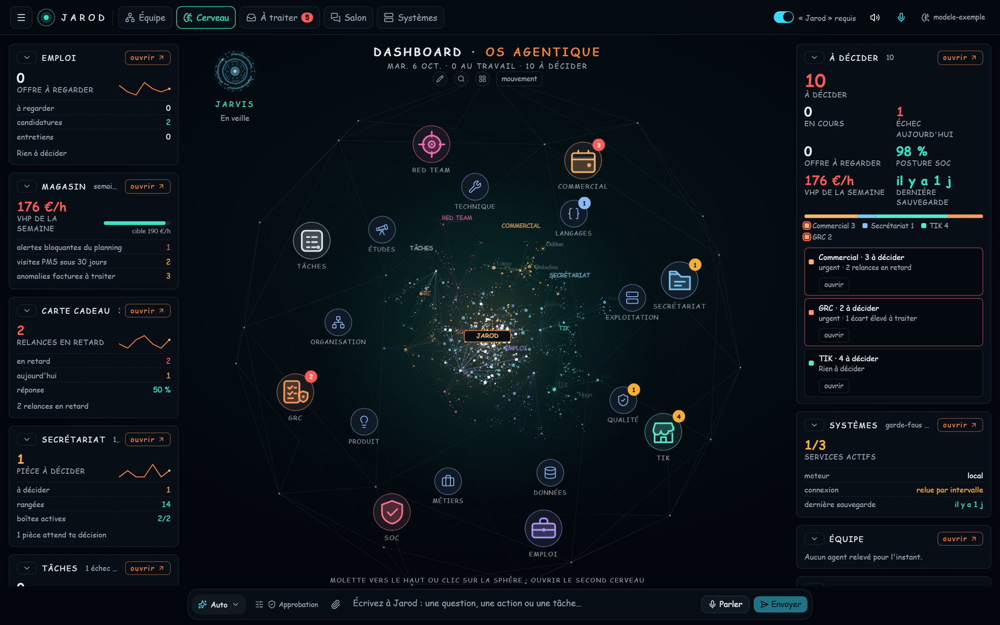

> **Ce que ça montre :** un point d'entrée unique. J'allume le PC, je vois où on en est.

---

## Étape 2 · Simplement parler

L'orbe Jarvis ouvre la conversation, à la voix ou au clavier. Hermes attend son mot d'activation. Je lui demande de m'aider à structurer un projet : ici, le site web d'une boulangerie. Hermes répond avec un plan structuré, puis propose de **déléguer** l'étape suivante au bon pôle.

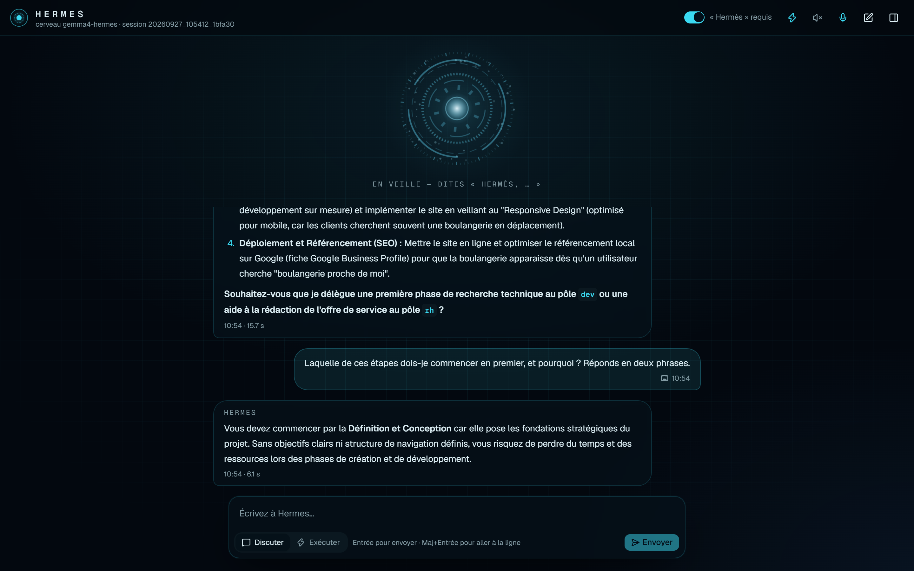

*Capture de septembre.*

> **Ce que ça montre :** le directeur réfléchit, puis oriente le travail. Il sait quel pôle fait quoi.

---

## Étape 3 · Une action m'attend

Je lui demande de *créer un fichier*. Cela modifie quelque chose sur mon PC : la tâche est classée **risque moyen** et s'arrête. L'orbe passe à l'ambre : **approbation requise**.

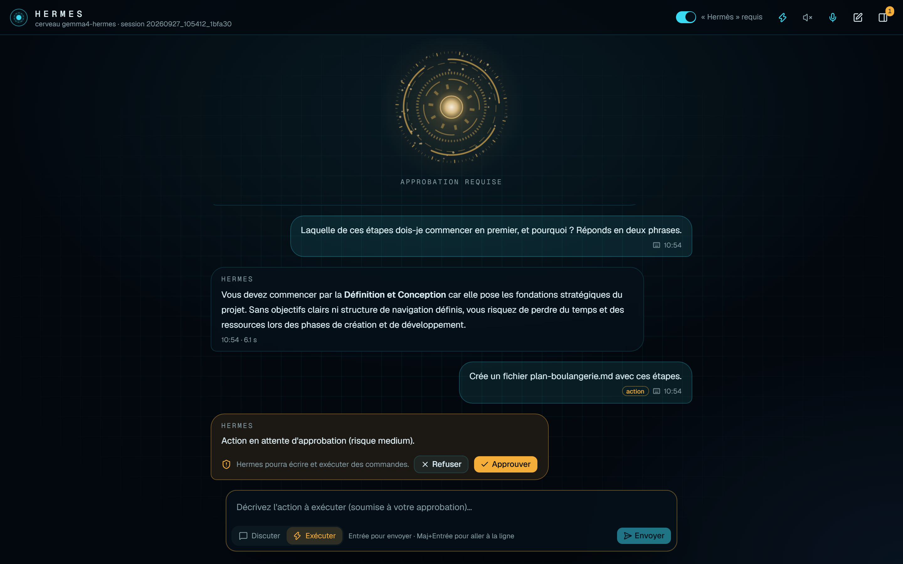

*Capture de septembre.*

> **Ce que ça montre :** l'humain dans la boucle. Rien de ce qui modifie ma machine ne s'exécute sans mon clic explicite.

---

## Étape 4 · Je garde la main

J'ai refusé cette action (ici, la même interface sur téléphone). Hermes confirme : **« Action refusée. »** Rien ne s'est exécuté.

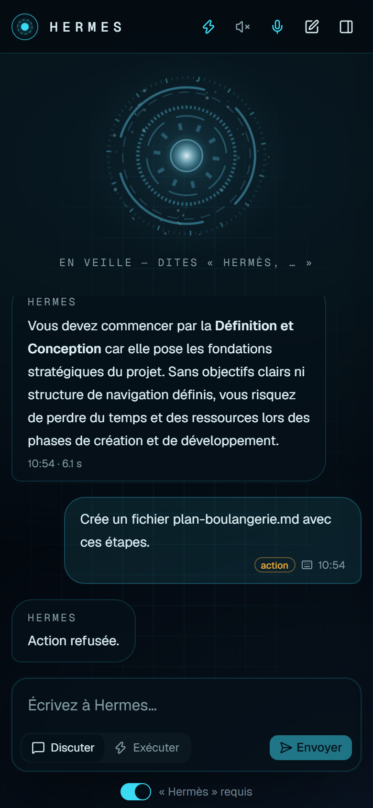

*Capture de septembre.*

> **Ce que ça montre :** un refus est définitif, et l'interface fonctionne aussi sur téléphone.

---

## Étape 5 · Voir l'équipe travailler

Je demande un vrai travail : chercher sur le web les recommandations officielles sur les mots de passe, puis écrire une synthèse en 5 points. J'approuve, et chaque étape réelle s'affiche en direct : la recherche web, sa durée, et même le début de ce que l'outil a renvoyé.

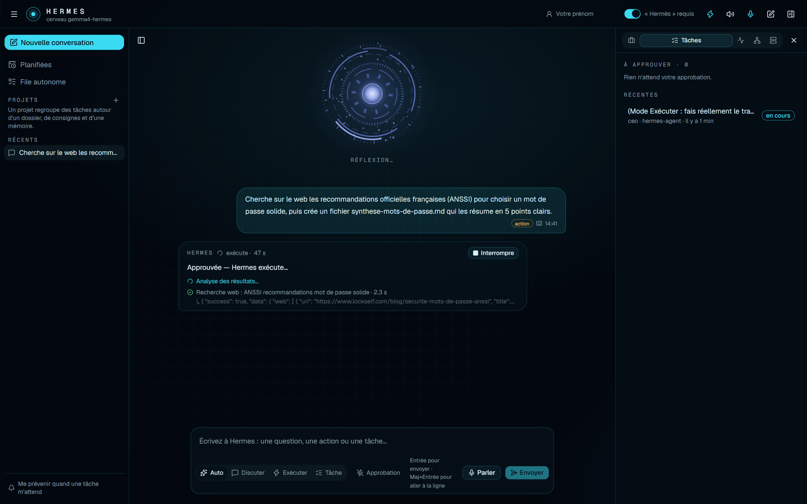

*Capture de septembre.*

Deux minutes plus tard, Hermes rend compte de ce qu'il a fait. Les livrables sont listés avec un bouton **Ouvrir le dossier**. *(Le chemin du dossier local est flouté.)*

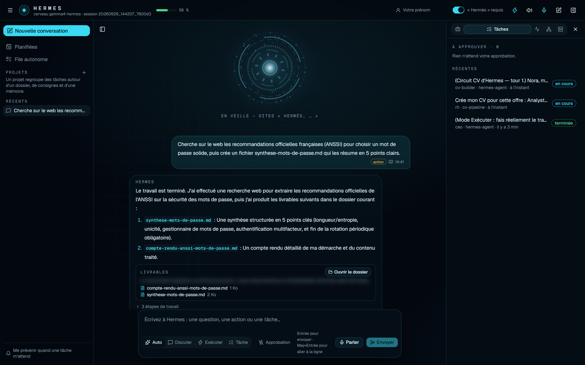

*Capture de septembre.*

Aujourd'hui, le **Second cerveau** montre aussi ces liens : qui délègue à qui, quel agent appelle quel outil, en direct.

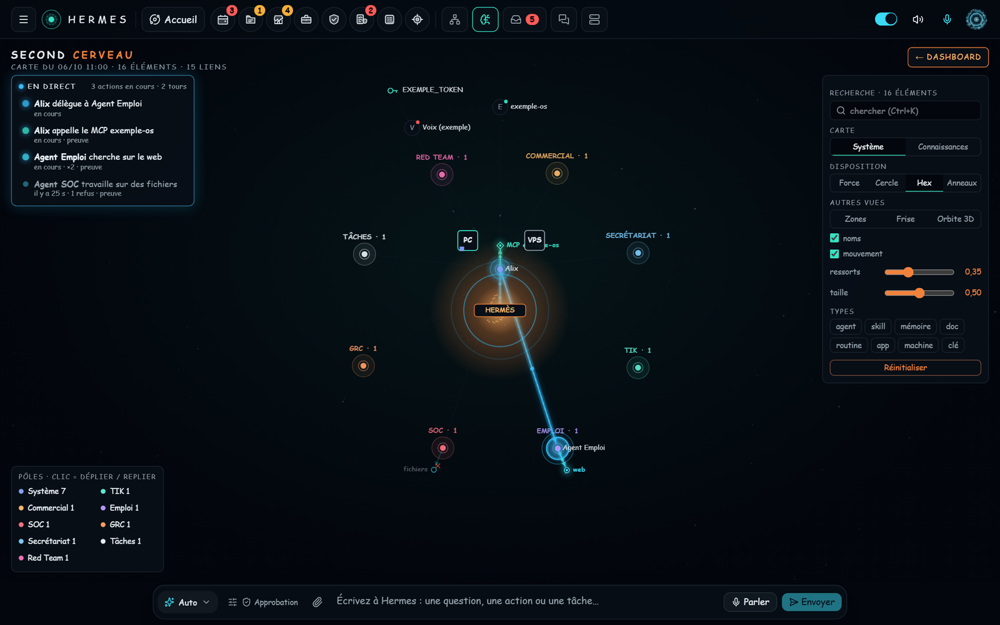

> **Ce que ça montre :** la transparence. Je vois *ce qui* est fait, étape par étape, pas une roue qui tourne. Et le résultat est un vrai fichier, pas une promesse.

---

## Étape 6 · Un CV construit à partir d'une annonce (candidat fictif)

Pour cette démonstration, l'outil de CV tourne sur une copie isolée avec un **candidat fictif**, Alex Martin. Je colle une annonce (fictive) d'analyste SOC junior et je demande : *« Crée mon CV pour cette offre. »*

Nora, la manager RH, lance le circuit CV : Camille rédige, Sacha relit. Le tour 1 n'a pas été validé : Camille a donc révisé le CV, et Sacha l'a validé au tour 2.

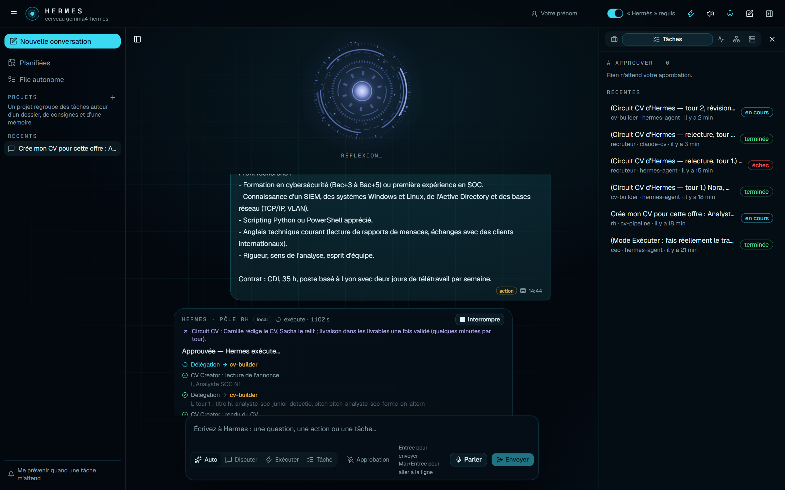

Le CV validé est livré (PDF design, PDF lisible par les logiciels de recrutement, Word, et un fichier de provenance qui relie chaque ligne à sa source). Et comme l'offre demande des choses que le profil ne montre pas, **Nora pose la question au candidat** au lieu de les inventer. *(Le chemin du dossier local est flouté.)*

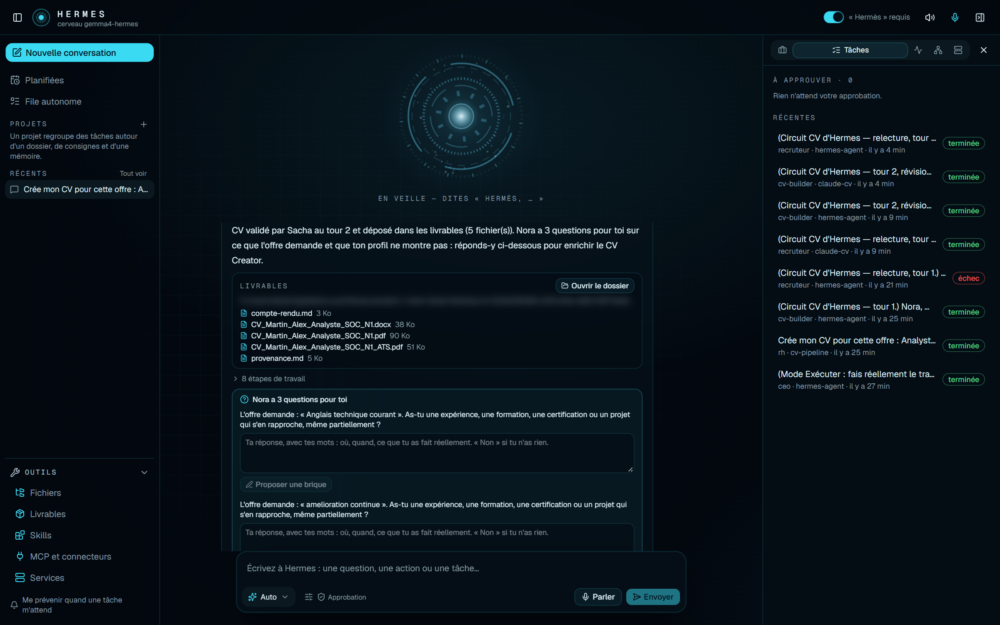

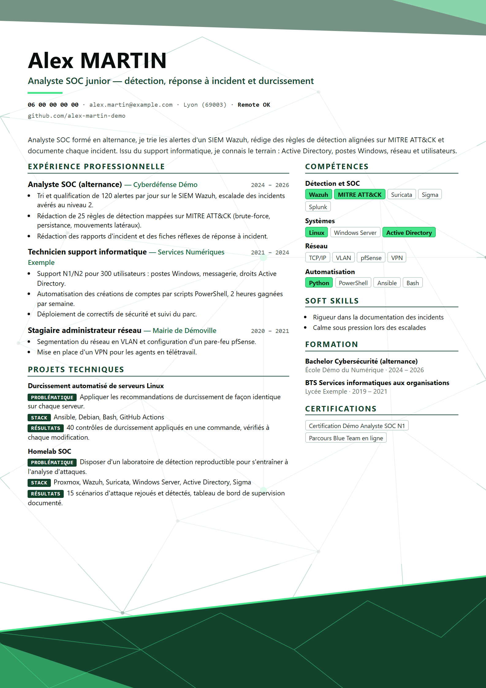 <i>Le CV produit pour le candidat fictif : une page, adaptée à l'offre, chaque ligne traçable.</i>

*Captures de septembre.*

> **Ce que ça montre :** un circuit multi-agents avec contrôle qualité intégré, et une IA qui demande au lieu d'inventer.

---

## Étape 7 · Demander à un spécialiste

Une question de débogage, d'architecture ou de droit ? Je la confie à un **bureau**. Le code présélectionne les candidats, le manager choisit, l'agent répond, le manager contrôle. Les agents de pôle peuvent faire la même chose quand ils butent sur un sujet hors de leur métier.

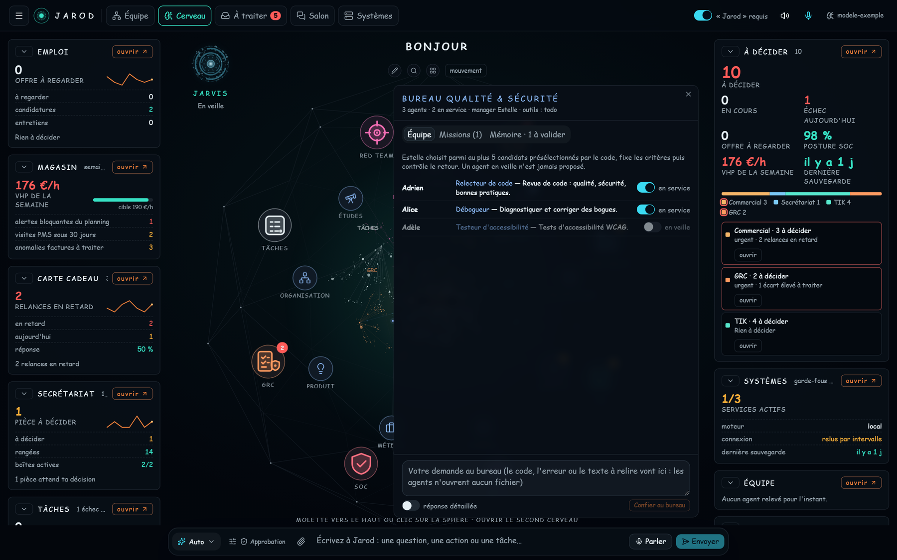

> **Ce que ça montre :** une flotte de spécialistes, sans pouvoir. Ils conseillent ; ils n'écrivent ni n'exécutent.

---

## Étape 8 · Faire tourner un magasin

Le matin, le tableau de bord du **Magasin** dit ce qui demande un geste : un relevé de température hors limite, un planning à préparer, un chiffre à saisir, une visite obligatoire qui approche. Tout est calculé par le code ; rien n'est envoyé.

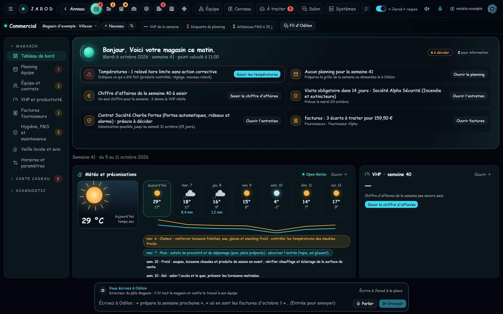

Le planning de la semaine est proposé par le code d'après les horaires, les contrats, les repos et les absences. Thomas le retouche, Claire le relit, et rien n'est enregistré sans mon clic.

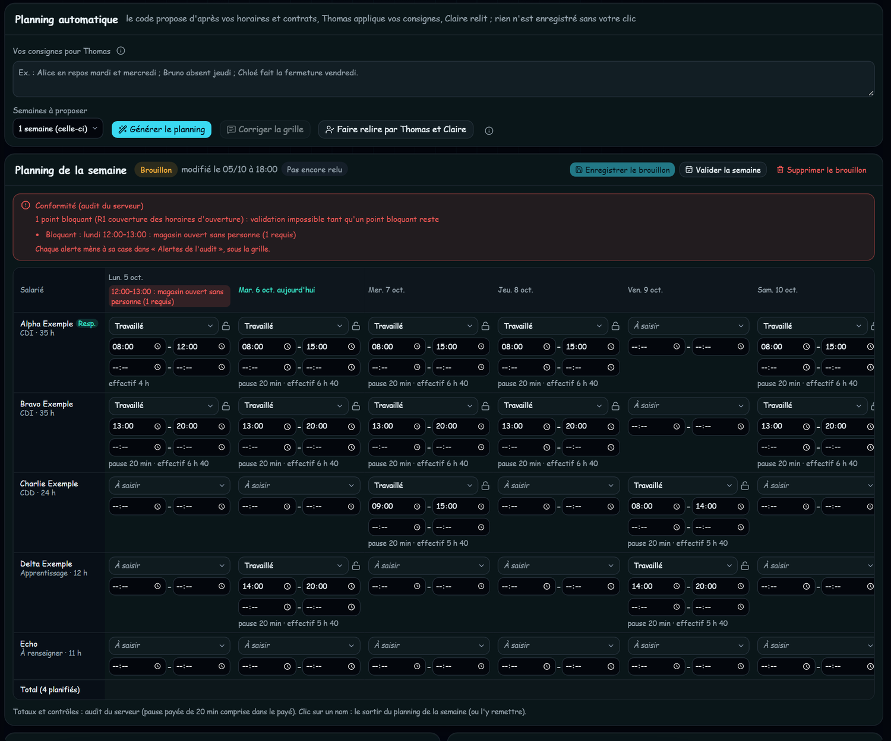

> **Ce que ça montre :** le système sert un vrai métier, avec des règles qui touchent des personnes. Le code calcule, les agents relisent, je valide.

---

## Étape 9 · Contrôler la santé du système

Tout ce que fait l'équipe est mesuré : qui a travaillé quand, combien de temps, avec quels outils, combien de jetons et pour quel coût. C'est aujourd'hui dans **Systèmes › Performance**.

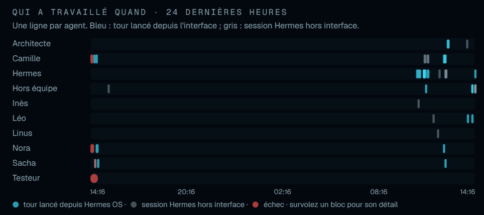

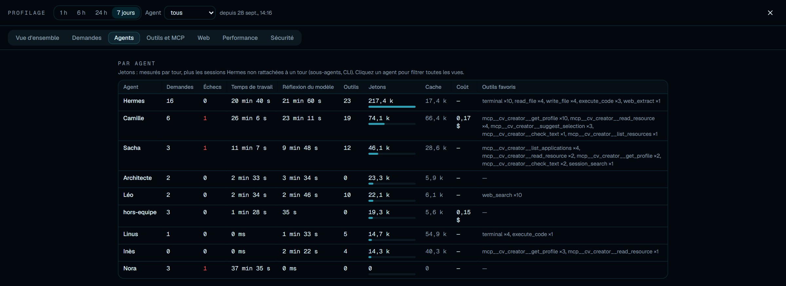

*Captures de septembre.*

> **Ce que ça montre :** l'observabilité. Rien n'est inventé ; chaque chiffre est traçable.

---

## Étape 10 · Le système se connaît

La carte de l'équipe, de ses compétences et de ses outils est générée à partir de ce qui est réellement installé. Je la lis dans le Second cerveau. Le directeur, lui, connaît son équipe par sa fiche. Injecter la carte complète à chaque tour coûte cher, donc c'est coupé par défaut, en attendant la mesure.

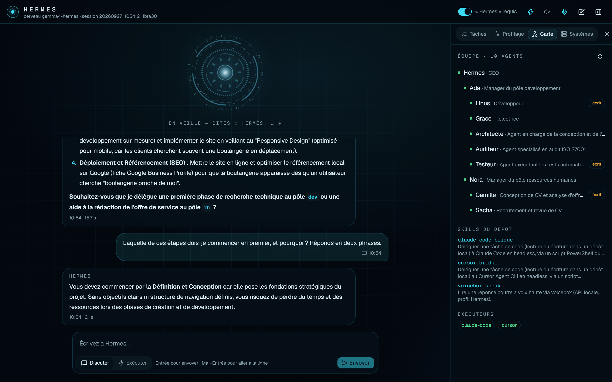

*Capture de septembre.*

> **Ce que ça montre :** une carte produite par le code, jamais recopiée à la main.

---

## En coulisses

- toutes les heures, une sauvegarde automatique de tout le système ;
- une recherche de secrets et de noms réels avant chaque sauvegarde : un mot de passe, une clé ou un nom la **bloque** ;
- des routines bornées par des plafonds, avec un journal : vérification nocturne des liens, reconstruction du Cerveau, autocontrôle ;
- une veille des offres d'emploi planifiée qui prépare son résumé.

---

Suite : [**L'équipe**](equipe.md) · [**Conception & architecture**](conception.md) · [**Décisions clés**](decisions.md)
